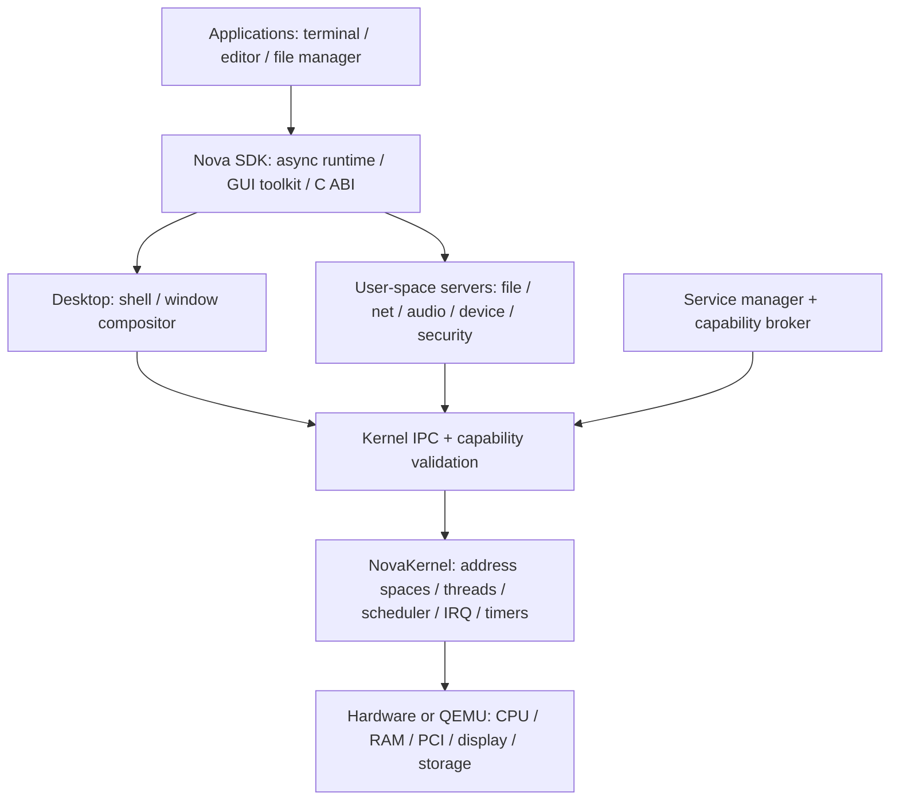
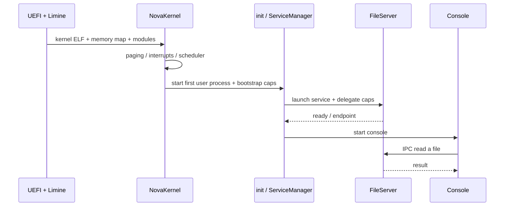

# NovaOS

**An experimental Rust-based desktop operating system featuring a lightweight microkernel, capability-based security, and modular user-space services.**

> 🚧 **Status: early design / pre-alpha.** NovaOS is not yet bootable and does not provide a desktop release. Features and milestones described below are planned unless explicitly marked as implemented.

NovaOS draws inspiration from Symbian OS's resource efficiency, client-server system services, and event-driven programming. It reimagines those ideas for modern 64-bit desktop computers, with an **independent Rust kernel** rather than a Linux-based distribution.

## Design Principles

- **Minimal kernel:** Keep scheduling, virtual memory, IPC, interrupt handling, and capability enforcement in the kernel.
- **Isolated system services:** Move file, network, device, audio, and display functionality into user-space processes where practical.
- **Capability-based security:** Grant access to specific objects through explicit, restricted handles instead of ambient authority.
- **Async-first programming:** Combine preemptive threads with event loops, efficient IPC, shared memory, and Rust `async`/`await`.
- **Resource efficiency:** Measure memory usage, latency, and idle overhead rather than relying on performance claims.
- **Desktop-focused evolution:** Start with a reliable command-line system, then build a modern graphical desktop.

These are engineering goals, not claims of formally verified security.

## Planned Architecture



| Component | Responsibility |
| --- | --- |
| **NovaKernel** | Threads, processes, scheduling, address spaces, interrupts, and kernel objects |
| **Capability System** | Fine-grained permissions, handle validation, delegation, and revocation |
| **Nova IPC** | Endpoints, messages, request/reply, notifications, and shared buffers |
| **Service Manager** | Service startup, dependencies, supervision, and recovery |
| **File Server** | In-memory filesystem first; virtual filesystems and persistent storage later |
| **Device Manager** | Controlled MMIO, IRQ, PCI, and virtual device access |
| **Nova Desktop** | Display service, compositing, input routing, windows, and UI components |

## Boot workflow chain



## Technology Stack

| Area | Initial choice |
| --- | --- |
| Main language | **Rust** (`no_std` in the kernel, plus minimal assembly where needed) |
| CPU architecture | **x86-64** first; AArch64 in the future |
| Development platform | **QEMU** with UEFI/OVMF |
| Boot protocol | **Limine** |
| Executable format | **ELF64** and a NovaOS-specific ABI |
| Initial device targets | Serial, timers, framebuffer, and VirtIO |
| Tooling | Cargo, QEMU, GDB, and a planned `xtask` workflow |

## Roadmap

All milestones are **planned**. They are engineering gates, not guaranteed delivery dates.

- [ ] **M0 — Foundation:** Repository, Rust workspace, architecture decisions, and QEMU test harness.
- [ ] **M1 — Boot:** UEFI boot, serial logging, exception handling, and memory-map validation.
- [ ] **M2 — Isolation:** Paging, user mode, processes, syscalls, threads, and preemptive scheduling.
- [ ] **M3 — Microkernel:** Capability tables, IPC, an `init` process, and an IPC echo service.
- [ ] **M4 — Command line:** Service Manager, RAMFS, File Server, console, and shell.
- [ ] **M5 — Storage:** PCI, VirtIO block devices, and VFS.
- [ ] **M6 — Desktop Alpha:** Input system, window compositor, terminal, editor, and file manager.
- [ ] **M7+ — Expansion:** Networking, SMP, package management, security hardening, and selected real hardware.

**First major architecture milestone:** two isolated Rust processes communicate through a capability-protected IPC endpoint.

See [NovaOS.md](NovaOS.md) for subsystem specifications, interface sketches, risks, testing strategy, and milestone acceptance criteria.

## Planned Repository Layout

```text
NovaOS/
├── kernel/               # Microkernel and architecture-specific code
├── crates/
│   ├── nova-abi/         # Shared syscall and ABI definitions
│   ├── nova-ipc/         # User-space IPC library
│   ├── nova-cap/         # Typed capability handles
│   └── nova-async/       # Async runtime
├── user/
│   ├── init/             # First user-space process
│   ├── services/         # System services
│   └── apps/             # Native applications
├── drivers/              # Device drivers
├── boot/                 # Boot configuration
├── tools/xtask/          # Build and QEMU automation
├── tests/                # Unit and integration tests
├── docs/                 # ADRs and technical specifications
├── NovaOS.md             # Detailed design plan
└── README.md
```

This structure is a **target layout**; individual directories will be created as implementation progresses.

## Building and Running

NovaOS builds with a pinned nightly toolchain, the `x86_64-unknown-none` bare-metal target, QEMU, and OVMF. `cargo xtask` owns the build/image/run sequencing.

```bash
# Fetch and verify the pinned Limine release (needed once per checkout)
cargo xtask fetch-limine

# Build the kernel and the user-space runtime for x86_64-unknown-none
cargo nova-build-bare

# Build a bootable ISO, then boot it under QEMU/OVMF with a serial console
cargo xtask image
cargo xtask run

# The full test suite: xtask's tests, the host unit tests, then the QEMU
# boot suite. Exits non-zero on a failure *or* a timeout.
cargo xtask test
```

### Quality gates

`scripts/gates.sh` runs the four gates the plan requires, in cheapest-first order:

```bash
scripts/gates.sh          # every gate
scripts/gates.sh fmt      # cargo fmt --all -- --check
scripts/gates.sh clippy   # cargo clippy -D warnings (host crates)
scripts/gates.sh test     # host unit tests
scripts/gates.sh kernel   # the bare-metal build
scripts/gates.sh boot     # the QEMU boot suite
```

The same commands are available individually:

| Command | What it does |
| --- | --- |
| `cargo nova-test-host` | The host unit tests, without the bare-metal binaries |
| `cargo nova-fmt` | `cargo fmt --all -- --check`, over the whole workspace |
| `cargo nova-clippy` | `cargo clippy -D warnings` over the host crates |
| `cargo nova-clippy-kernel` | The same, for the bare-metal binaries, on the bare-metal target |
| `cargo nova-build-bare` | The kernel and the user runtime, for `x86_64-unknown-none` |
| `cargo nova-build` | The kernel, for `x86_64-unknown-none` |

> **The kernel is not a host program.** `nova-kernel` and `nova-rt` are `no_std` / `no_main` bare-metal binaries with their own `_start` and their own linker scripts. Building either for the host fails with `unwinding panics are not supported without std` — an error that reads like a broken toolchain and is really a bare-metal binary being built for the wrong target. They are excluded from the host gates and built by `nova-build-bare` instead.

Every QEMU run writes its serial log to `target/novaos/run/serial.log` and archives a timestamped copy under `target/novaos/run/archive/`.

## Contributing

NovaOS welcomes future collaboration on Rust systems programming, operating-system architecture, documentation, drivers, and testing.

Useful early contributions include architecture reviews, ABI and IPC design feedback, QEMU automation, host-side unit tests, and focused Rust components. Before implementing a large subsystem, discuss its scope in a GitHub issue. New `unsafe` code should document its safety assumptions and include relevant tests.

## License

Apache License 2.0 

---

**NovaOS — Small kernel. Strong boundaries. Open possibilities.**
