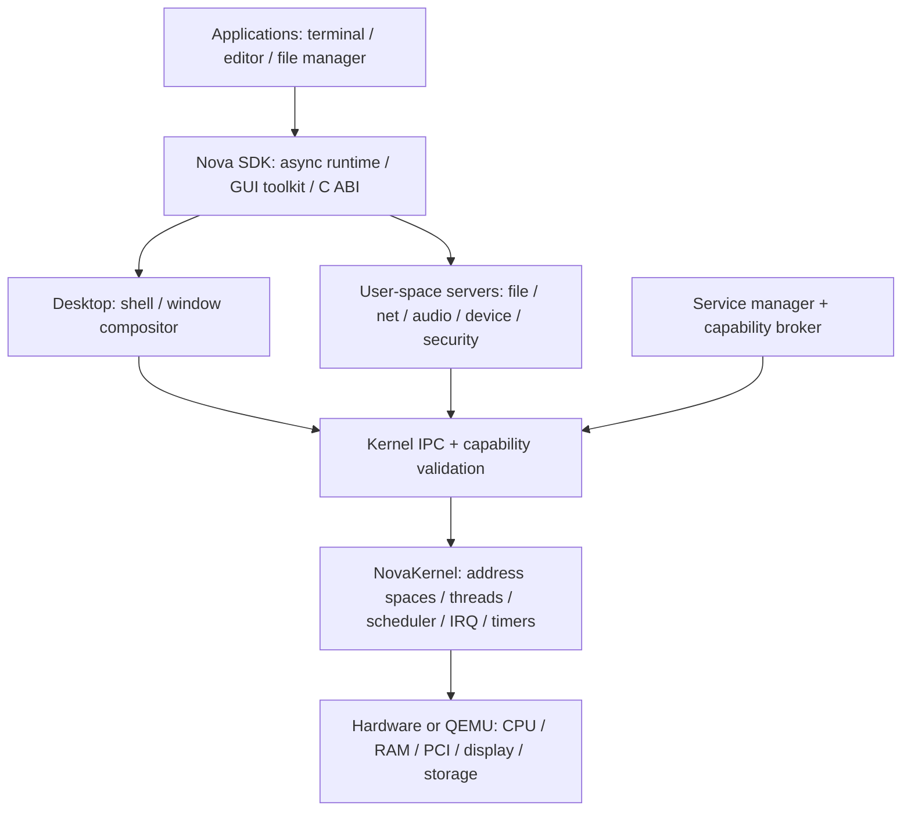
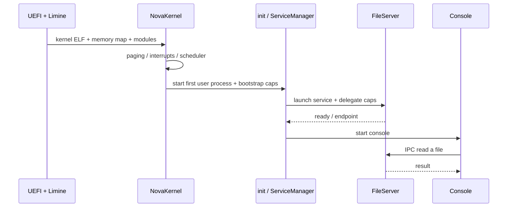
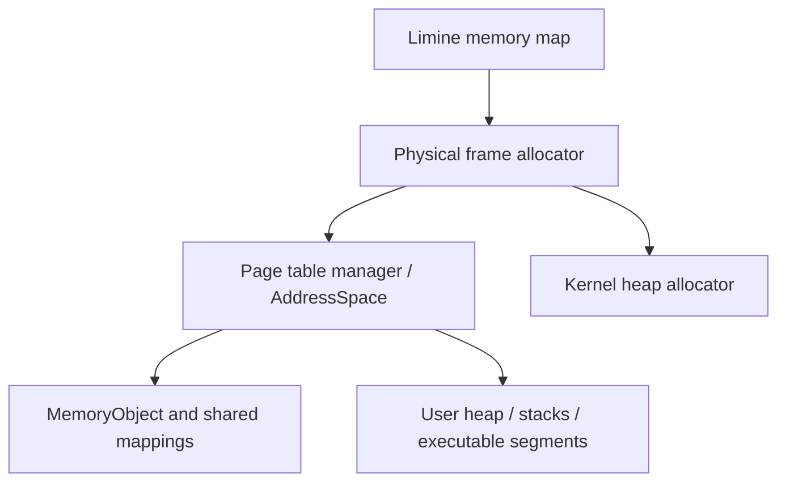
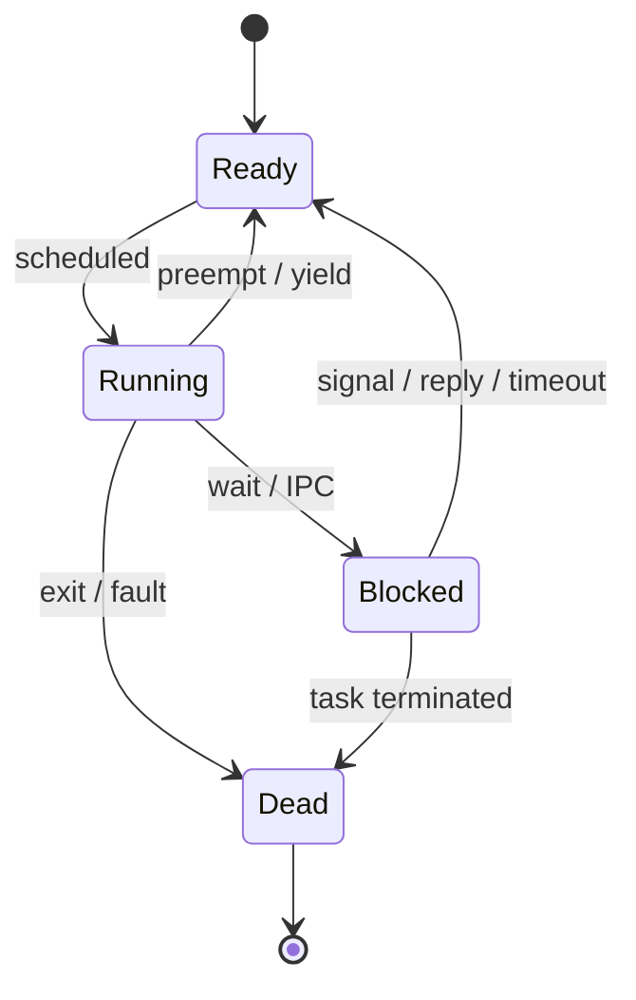
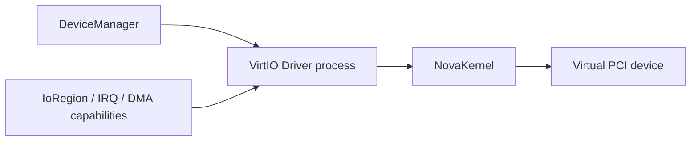
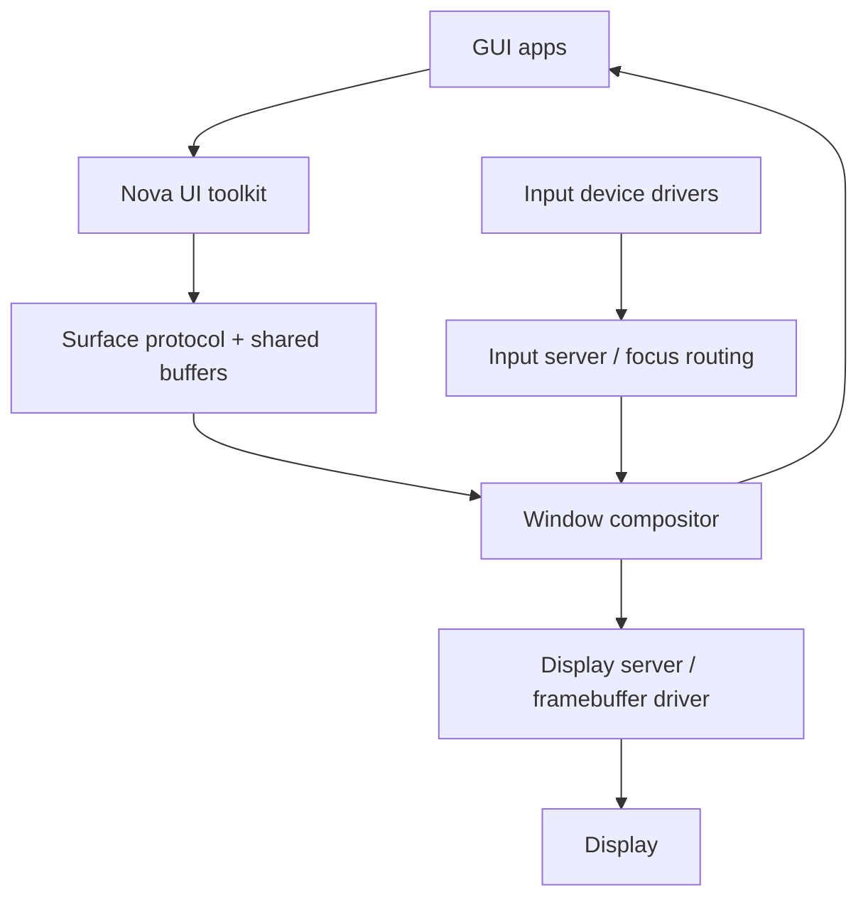
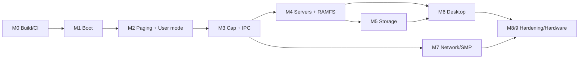

# NovaOS 详细设计计划书

> **NovaOS — A small kernel, a capable desktop.**  
> **文档类型**：系统架构设计 + 工程实施计划 + 接口草案  
> **文档版本**：v0.1.0（设计草案）  
> **编制日期**：2026-10-22  
> **目标平台**：x86-64（首发）；AArch64（远期）；LoongArch64（远期） ；Riscv64（远期） 
> **实现语言**：Rust（主体）+ 必需的少量汇编  
> **项目状态**：拟建项目；文中代码和接口均为规划，不代表已实现或已通过编译。  
> **设计基线**：独立内核、实用微内核、用户态系统服务、Capability 安全、异步事件驱动、现代桌面。

---

## 目录

1. [项目概述与边界](#1-项目概述与边界)
2. [从 Symbian 吸收什么、放弃什么](#2-从-symbian-吸收什么放弃什么)
3. [架构原则与关键决策](#3-架构原则与关键决策)
4. [总体架构](#4-总体架构)
5. [仓库与 Rust 工程规范](#5-仓库与-rust-工程规范)
6. [启动流程和硬件平台](#6-启动流程和硬件平台)
7. [微内核与内核对象模型](#7-微内核与内核对象模型)
8. [物理内存和虚拟内存](#8-物理内存和虚拟内存)
9. [进程、线程与调度](#9-进程线程与调度)
10. [Capability 权限系统](#10-capability-权限系统)
11. [IPC 协议与异步运行时](#11-ipc-协议与异步运行时)
12. [系统服务与启动管理](#12-系统服务与启动管理)
13. [驱动架构与硬件接入](#13-驱动架构与硬件接入)
14. [文件系统与持久化存储](#14-文件系统与持久化存储)
    14.5 [操作系统文件是如何组织的](#145-操作系统文件是如何组织的)
15. [图形、桌面与输入系统](#15-图形桌面与输入系统)
16. [应用程序模型与 SDK](#16-应用程序模型与-sdk)
17. [安全、故障恢复与更新](#17-安全故障恢复与更新)
18. [性能目标和观测体系](#18-性能目标和观测体系)
19. [测试和质量保证](#19-测试和质量保证)
20. [版本路线图与验收门槛](#20-版本路线图与验收门槛)
21. [可执行任务拆解与依赖](#21-可执行任务拆解与依赖)
22. [首八周实施安排](#22-首八周实施安排)
23. [关键 Rust 代码与 ABI 示例](#23-关键-rust-代码与-abi-示例)
24. [架构决策记录（ADR）](#24-架构决策记录adr)
25. [风险、取舍与停损条件](#25-风险取舍与停损条件)
26. [参考资料](#26-参考资料)
27. [附录：术语和 Definition of Done](#27-附录术语和-definition-of-done)

---

# 1. 项目概述与边界

## 1.1 项目定位

NovaOS 是一个以桌面使用场景为最终方向、从零编写独立内核的 64 位操作系统。它继承 Symbian OS 在资源节制、Client-Server 系统服务和异步处理方面的优秀思想，同时吸收现代对象能力安全模型与桌面图形协议的经验。

**项目目标不是克隆 Symbian，不是 Linux 发行版，也不是一开始就替代 Windows。**

要回答的核心研究问题：

> 能否用一个小而清晰的 Rust 内核、受 Capability 保护的 IPC，以及可独立维护的用户态系统服务，构建逐步可用的现代桌面系统？

## 1.2 三层目标

| 层次 | 目标 | 成功定义 |
| --- | --- | --- |
| G1：内核正确性 | 在 QEMU 中稳定运行的独立内核 | 内存隔离、系统调用、线程调度、IPC 通过测试 |
| G2：操作系统完整性 | 实际可用的命令行环境 | 多进程、文件、驱动、服务管理、错误恢复 |
| G3：桌面实用性 | 初步完整的 GUI 工作流 | 多窗口、键鼠、文件管理器、终端、简单应用 |

三层目标应依次交付，不要以 GUI 演示掩盖内核稳定性不足。

## 1.3 明确的首版边界

**首选硬件环境：**

- x86-64，4 级页表，4 KiB 基础页大小；
- QEMU `q35` 虚拟机、OVMF/UEFI 固件；
- Limine 引导程序；内核为 ELF64；
- 最初单核（`-smp 1`），之后支持 2/4 核；
- 虚拟串口、基础 framebuffer、VirtIO 虚拟设备；
- 首次 GUI 版本先做软件合成，再开发 GPU 加速。

**v0.1～v0.3 明确不做：**

- 原生运行 Windows/macOS/Linux 现有二进制；
- 对所有真实 PC 硬件提供驱动；
- 浏览器引擎、Office 套件、完整多媒体栈；
- 一开始就实现 POSIX 全覆盖；
- 一开始就追求形式化验证或硬实时保证；
- USB-C、Wi-Fi、蓝牙、休眠和复杂电源管理；
- 直接让一个内核组件以最高权限承担所有系统服务。

## 1.4 非功能性要求

| 编号 | 要求 | 初期评价方式 |
| --- | --- | --- |
| NFR-01 | 进程间地址空间隔离 | 故意越界的用户进程被终止，其他进程继续 |
| NFR-02 | 默认最小权限 | 无授权句柄访问服务或映射资源返回拒绝 |
| NFR-03 | IPC 行为可预测 | 定义消息上限、超时、背压、取消与错误码 |
| NFR-04 | Rust 内存安全优先 | `unsafe` 范围受控并有安全前置条件 |
| NFR-05 | 可调试、可复现 | 固定工具链、串口日志、QEMU 自动测试 |
| NFR-06 | 可扩展到桌面 | GUI、文件服务、输入事件不与内核紧耦合 |
| NFR-07 | 故障隔离 | 单个普通服务失败不导致内核 panic |
| NFR-08 | 架构可移植 | 将 x86-64 特有机制限制在 `arch/x86_64` |

---

# 2. 从 Symbian 吸收什么、放弃什么

## 2.1 核心取舍表

| Symbian 机制 | NovaOS 策略 | 原因 |
| --- | --- | --- |
| EKA2 纳内核分层思想 | 继承“底层执行机制 / 内核对象服务”分层 | 隔离硬件细节，缩小核心代码范围 |
| Client-Server | **重点继承**，公共服务运行于用户态 | 便于隔离、测试、升级与故障恢复 |
| Active Object / Active Scheduler | 保留事件循环思想，改用 Rust Future、`async/await` | 简化 SDK 的异步编程 |
| IPC | 从系统第一阶段设计，不后补 | 直接决定微内核的易用性与效率 |
| 平台能力权限 | 升级为对象 Capability | 权限与具体资源绑定，可受控转授 |
| 节省线程、内存 | 保留，但不牺牲 SMP 与交互响应 | 适应多核桌面负载 |
| Symbian 专用 C++ 约定 | 不继承 | Rust 所有权、`Result`、RAII 更合适 |
| S60 / UIQ | 不移植 | 改建桌面合成器和现代 UI 工具包 |
| 手机电话实时优先级 | 不照搬 | 桌面主要关注公平性、输入延迟和音频期限 |

**概念澄清：** Symbian 的平台 Capability（按进程准入受控 API）不同于 seL4 式对象 Capability（持有不可伪造的对象访问凭证）。NovaOS 吸收两者的最小授权理念，新的原生权限基础以**对象引用、细分权利、明确转授**为准。

## 2.2 必须避免的历史负担

1. 不做复杂、难以理解的专属语言异常机制；
2. 不要求应用理解内核细节才能写异步代码；
3. 不让服务调用全部变成昂贵的多次内存复制；
4. 不让桌面 API 直接依赖单一设备驱动；
5. 不让开发者为了简单文件访问经历不可解释的证书流程。

---

# 3. 架构原则与关键决策

## 3.1 十条不可轻易推翻的原则

1. **机制与策略分离**：内核负责调度原语、IPC、映射和安全检查；用户态服务负责大部分策略。
2. **默认拒绝**：没有 Capability 的操作不能因“知道资源名字”而成功。
3. **先正确，再快**：先做完整的慢路径，再做 IPC fast path。
4. **小消息与大数据分流**：控制指令用小消息；大块数据用共享内存和完成通知。
5. **内核中的 `unsafe` 集中封装**：页表、上下文切换、MMIO 和 FFI 必须有显式安全契约。
6. **用户态服务可替换**：文件、网络、图形协议版本化。
7. **异步不是到处创建线程**：应用可用事件循环；内核仍有抢占式调度。
8. **性能必须可量化**：记录 IPC、内存、调度、启动与图形的量化数据。
9. **先支持一套虚拟硬件**：用 QEMU 降低环境变化。
10. **每个阶段有可执行验收**：未达验收条件，不叠加下一层的复杂性。

## 3.2 建议冻结的初始技术决策

| 决策 | v0.1 选择 | 将来如何变化 |
| --- | --- | --- |
| 内核语言 | Rust Edition 2024；`#![no_std]` | 不改变主体语言 |
| 特殊底层代码 | 少量 `global_asm!` / 汇编入口 | 可增加独立架构入口 |
| 构建工具 | Cargo workspace + `xtask` | 后期加入镜像打包与签名 |
| 编译目标 | `x86_64-unknown-none` | 加入自定义 userland target |
| 引导 | Limine + UEFI/OVMF | 将 boot 协议适配层独立 |
| 内存页 | 4 KiB、4 级页表 | 后续 huge page / LA57 |
| CPU | 先单核 | 再 SMP、每核运行队列 |
| 进程模型 | 独立地址空间 + 多线程 | 后期 COW、线程组优化 |
| IPC | Endpoint + reply token + bounded message | 共享内存和批量操作 |
| 安全 | 每进程能力表，权利只能收缩 | 资源配额与审计细化 |
| 用户二进制 | ELF64 + 自有 `nova-abi` | 后期 libc/POSIX |
| 初期文件系统 | RAMFS | VFS → VirtIO 块设备 → 持久化 |
| GUI | framebuffer 软件合成 | GPU 驱动和更复杂场景图 |
| 仓库模式 | Monorepo | 接口成熟后允许拆仓 |

> **重要说明：** `x86_64-unknown-none` 不包含 `std`，也不提供默认分配器；用户态如需完整 Rust `std`，必须为 NovaOS 实现相应平台支持，或在前期直接基于 `core` 与 `alloc` 开发。不要假设更改目标三元组即可使用标准库。

---

# 4. 总体架构

## 4.1 逻辑组件



这是**逻辑依赖图**，不是每一次 API 调用的强制执行路径。共享内存缓冲区的数据读写不会每个字节都调用内核。

## 4.2 控制面与数据面

**控制面**：创建对象、请求权限、建立连接、启动服务、发送操作码、小消息通知。  
**数据面**：映射的内存页、显存缓冲、音视频帧、文件缓存等大数据。

例如一个视频缓冲在两个服务之间传递：

1. Client 持有 MemoryObject 的受限共享能力；
2. 通过 IPC 传给媒体服务；
3. 内核验证授权，完成映射权限配置；
4. 媒体服务在映射区读写数据；
5. 提交完成事件和同步标识给合成器；
6. 根据所有权协议复用或归还缓冲。

安全边界必须记录：何时谁可写、何时谁可读、缓冲何时复用、撤权是否需要取消映射。**绝不能单纯传原始指针跨进程。**

## 4.3 典型启动链



**自举顺序是一个关键难点**：不能在拥有文件系统之前要求从磁盘加载第一个文件服务器。初版用 bootloader 提供的 initramfs 模块，由内核解析 ELF 载入第一个 `init` 进程；再由 `init` 启动其他服务。

---

# 5. 仓库与 Rust 工程规范

## 5.1 推荐 monorepo 目录结构

```text
NovaOS/
├── README.md
├── NovaOS.md                       # 本设计计划书
├── LICENSE-APACHE
├── LICENSE-MIT
├── rust-toolchain.toml             # 提交已验证的具体工具链版本
├── Cargo.toml                      # workspace 根
├── Cargo.lock                      # 提交，保证构建可复现
├── .cargo/
│   └── config.toml                 # targets / build aliases
├── kernel/
│   ├── Cargo.toml
│   └── src/
│       ├── main.rs                 # no_std / no_main / kernel entry glue
│       ├── arch/x86_64/            # GDT / IDT / APIC / syscall / context
│       ├── boot/                   # boot protocol adapter, BootInfo
│       ├── mm/                     # frame allocator / vmm / heap
│       ├── object/                 # kernel object definitions
│       ├── cap/                    # per-process capability table
│       ├── task/                   # process / thread / scheduler
│       ├── ipc/                    # endpoints / messages / replies
│       ├── sync/                   # spinlock / wait queue
│       ├── irq/                    # routing / event notification
│       ├── time/                   # clock / timers
│       ├── log/                    # kernel logging
│       └── syscall/                # stable kernel/user ABI boundary
├── crates/
│   ├── nova-abi/                   # no_std, plain ABI types + constants
│   ├── nova-protocols/             # service protocol schemas
│   ├── nova-cap/                   # typed capability wrappers
│   ├── nova-ipc/                   # userspace syscall wrappers
│   ├── nova-async/                 # single-threaded executor first
│   ├── nova-elf/                   # strictly validated ELF parsing
│   ├── nova-utils/                 # allocation-free shared primitives
│   └── nova-ui/                    # future GUI widget library
├── user/
│   ├── init/                       # first userspace process
│   ├── services/
│   │   ├── file-server/
│   │   ├── device-manager/
│   │   ├── console-server/
│   │   ├── security-broker/
│   │   ├── display-server/
│   │   ├── input-server/
│   │   ├── network-server/
│   │   └── package-manager/
│   └── apps/
│       ├── hello/
│       ├── shell/
│       ├── terminal/
│       ├── file-manager/
│       └── text-editor/
├── drivers/
│   ├── uart/
│   ├── virtio-blk/
│   ├── virtio-net/
│   ├── virtio-gpu/
│   ├── ps2/
│   └── pci/
├── boot/
│   ├── limine.conf
│   └── initramfs.manifest
├── tools/
│   └── xtask/
├── tests/
│   ├── host/
│   ├── qemu/
│   ├── negative/
│   └── stress/
├── scripts/
│   └── ...
├── docs/
│   ├── adr/
│   ├── abi/
│   ├── protocols/
│   ├── threat-model.md
│   ├── boot-contract.md
│   └── debugging.md
└── .github/workflows/
    └── ci.yml
```

注意：这是**目标结构**，不要求第 1 天一次性创建所有包。推荐先创建 `kernel`、`nova-abi`、`xtask`，随阶段逐步增加。

## 5.2 crate 边界

- `nova-abi`：只包含固定布局的 C ABI 值、系统调用号和错误码，不依赖设备或平台业务逻辑。
- `nova-protocols`：定义服务协议的类型与版本；避免直接序列化 Rust 内存布局。
- `nova-elf`：独立于内核，可在宿主机上大量 fuzz/测试。
- `kernel`：不得反向依赖任意 GUI、桌面应用或者磁盘文件系统业务 crate。
- `drivers`：优先用户态，最初为 QEMU 的简化硬件实现例外驱动须在文档标注。

## 5.3 Rust 代码质量约束

- 内核使用 `#![no_std]`、`#![no_main]` 和 `#![deny(unsafe_op_in_unsafe_fn)]`；
- 根据编译器要求，正确使用 Rust 2024 Edition 的 unsafe 属性语法；
- 不在内核使用不必要的全局可变状态，优先一次性初始化对象；
- 中断上下文禁用睡眠、阻塞 IPC 与可能分配内存的操作；
- 锁必须记录顺序，禁止持有关键自旋锁进入潜在阻塞调用；
- `unsafe` 必须紧邻 `// SAFETY:` 注释，说明所依赖的不变量；
- 没有 `alloc` 之前，使用静态有界对象池；提供堆分配器之后再使用 `Vec` / `Box`；
- 避免编译时默默关闭整数越界检查；边界和长度全部显式检查；
- 所有跨进程输入都当作不可信的字节序列，先验证后使用；
- 测试逻辑尽量放在可以使用宿主机 `std` 的纯 Rust crate 中。

## 5.4 建议的工具链策略

**推荐：锁定一个已验证的 stable Rust toolchain；需要不稳定特性时为单个原因建立 ADR。**

初版裸机 `x86_64-unknown-none` 是 Rust 官方支持的构建目标，可由 `rustup target add` 安装；实际内核打包还需要引导协议数据结构、链接配置和镜像生成脚本，`cargo build` 本身**不会**生成可启动的 ISO。

不得把网络教程的过时 `bootloader` crate 配置与新 Limine 配置混用。Limine 协议及 Rust 绑定有版本演进，选定版本后应同时固定协议修订版、Rust crate、bootloader 发行版和测试镜像。

---

# 6. 启动流程和硬件平台

## 6.1 v0.1 启动方案

```text
QEMU machine (q35)
      |
OVMF / UEFI firmware
      |
Limine bootloader
      |
NovaKernel ELF64  +  initramfs
      |
BootInfo adapter
      |
x86-64 arch_init  ->  memory_init  ->  scheduler_init
      |
first user-space task: init
      |
services + shell
```

### 首先请求的 bootloader 信息

1. 内存映射（保留区、可用页、内核占用）；
2. 可选 framebuffer 信息；
3. initramfs / 模块列表；
4. 内核可见地址映射信息（例如 HHDM）； 
5. SMP 信息（后续阶段）；
6. ACPI RSDP（中期）。

所有 Limine 返回的指针与内存区域必须依据实际所选协议版本的生命周期约束读取。**内核建立自己的内存管理后，不允许继续随意使用已释放的 bootloader 页面。**

### v0.1 启动检查清单

- [ ] 产出 `nova-kernel.elf`；
- [ ] 通过 Limine 在 UEFI QEMU 启动；
- [ ] 串口出现版本号和内存映射摘要；
- [ ] 设置可用的 GDT/IDT/TSS 和异常处理；
- [ ] 主动触发测试异常能打印寄存器和错误码；
- [ ] QEMU 退出码能被测试脚本识别；
- [ ] 对异常、坏 BootInfo 等情形给出明确失败路径。

## 6.2 早期硬件支持

| 设备 | v0.1 接入 | 常驻形式 |
| --- | --- | --- |
| 串口（COM1） | 必需，打印日志 | 内核极简调试驱动 |
| 定时器 | 必需，时钟和抢占 | 内核机制 |
| PIC/APIC | 渐进切换 | 内核中断控制 |
| Framebuffer | 可选，GUI 阶段必需 | 初期映射，后期由 DisplayService 管理 |
| 虚拟磁盘 | 中期 VirtIO Block | 用户态驱动优先 |
| 虚拟网卡 | 后期 VirtIO Net | 用户态驱动 |
| 键鼠 | GUI 阶段，先 QEMU 输入设备 | InputService + 驱动 |
| GPU 加速 | 非首版目标 | 后期 VirtIO GPU / 真机 GPU |

## 6.3 从单核扩展到 SMP

**单核阶段：** 只需要一个运行队列和一组中断/时钟状态。  
**多核阶段：** 增加 AP 启动、per-CPU 数据、按核分配内核栈、每核运行队列、IPI、TLB shootdown 与锁顺序证明。

### SMP 进入条件

- 单核内存分配、线程切换、抢占和用户态异常全部稳定；
- 能正确处理线程退出与等待队列移除；
- 所有可跨核共享的数据结构已划清同步责任；
- 没有使用仅在单核上凑巧正确的“关闭中断等于全局互斥”假设。


# 7. 微内核与内核对象模型

## 7.1 职责边界

**纳入内核：**

- 中断、异常、时钟与 CPU 上下文切换；
- 物理内存分配、地址空间映射、页表权限；
- 线程状态、调度、同步等待原语；
- 内核对象的创建、引用和生命周期；
- 进程 Capability 表以及内核权限检查；
- IPC Endpoint、消息传递、一次性回复；
- 向受授权驱动暴露受控 MMIO / I/O Port / IRQ 能力；
- 用户态/内核态切换与可信复制。

**原则上不纳入内核：**

- 文件路径解析、目录、磁盘文件系统逻辑；
- TCP/IP、DNS、HTTP；
- 窗口管理、主题、桌面 Shell；
- 音频混音和视频编解码；
- 用户管理的业务策略与图形权限弹窗；
- 软件包仓库和更新策略。

例外必须具有明确的自举理由与移出内核的计划。

## 7.2 基本内核对象

| 对象 | 对应权限示例 | 谁可以获得 |
| --- | --- | --- |
| `Task` | INSPECT、CONTROL | 创建任务的监督进程 |
| `Thread` | START、STOP、SET_PRIORITY | 持有线程控制 Capability 的主体 |
| `AddressSpace` | MAP、UNMAP、INSPECT | 受授权内存管理主体 |
| `MemoryObject` | READ、WRITE、MAP、SHARE | 经明确授予的持有者 |
| `Endpoint` | SEND、RECEIVE、GRANT | Client/Server |
| `ReplyToken` | REPLY（一次性） | 处理当前请求的 Server |
| `Notification` | SIGNAL、WAIT | 服务和驱动 |
| `Irq` | BIND、ACK | 设备驱动进程 |
| `IoRegion` | READ、WRITE、MAP | 设备管理器委托的驱动 |
| `TaskFactory` | CREATE | `init`/受控服务管理器 |

对象权限 **不能通过简单整数位或特殊 PID 自动推导**，必须在内核所维护的持有者能力表中验证。

## 7.3 内核态错误处理

内核 API 统一返回固定 ABI 错误码：

| 名称 | 数值建议 | 意义 |
| --- | ---: | --- |
| `OK` | 0 | 成功 |
| `E_INVALID` | 1 | 参数非法或结构体无效 |
| `E_BAD_HANDLE` | 2 | 能力句柄不存在或已失效 |
| `E_DENIED` | 3 | 对象权限不足 |
| `E_NO_MEMORY` | 4 | 可用内存或对象配额不足 |
| `E_BUSY` | 5 | 资源正在使用 |
| `E_TIMEOUT` | 6 | 到期未完成 |
| `E_CLOSED` | 7 | Endpoint / 对象关闭 |
| `E_PEER_DIED` | 8 | 对端线程/进程退出 |
| `E_BUFFER_SMALL` | 9 | 缓冲不足 |
| `E_UNSUPPORTED` | 10 | 版本或操作不支持 |
| `E_INTERRUPTED` | 11 | 可中断等待被打断 |
| `E_QUOTA` | 12 | 触发对象数量或消息配额 |
| `E_WOULD_BLOCK` | 13 | 非阻塞操作暂无结果 |
| `E_REVOKED` | 14 | 授权被撤销 |

初步规定：`RAX >= 0` 代表成功返回值，`RAX < 0` 代表 `-E_*`。`nova-abi` 固定每个错误码；内核与 SDK 必须有同一份来源，不能各自手写一套。

## 7.4 内核入口与中断栈

- 系统调用入口为体系结构专属程序集，明确保存/恢复通用寄存器；
- x86-64 `syscall` 不自动切换内核栈，必须设计可信的 per-CPU 栈切换与 `swapgs` 使用；
- 在完成用户地址检查、规范地址验证及安全返回路径前，优先采用保守的 `iretq` 返回设计；不要贸然使用 `sysretq`；
- 外部中断在可正确重入之前保持严格受控；
- 每个线程配置独立内核栈或明确受控的调用栈方案；
- CPU 特定状态（例如 FPU/SIMD）要保存或限制使用，不得因编译器优化破坏用户态状态。

### 核心不变量

1. 用户地址绝不会未经检查便被内核直接信任；
2. 用户代码不能映射或写入内核专有页；
3. `Task`/`Thread` 对象销毁时，不留下可访问的悬挂指针；
4. 同一个 ReplyToken 只能成功回复一次；
5. 没有可发送能力的进程不能访问受保护 Endpoint；
6. 所有等待队列在退出、超时、撤权和服务死亡路径都会清理。

---

# 8. 物理内存和虚拟内存

## 8.1 内存子系统层次



## 8.2 物理页管理（PMM）

**第一阶段：** 基于启动内存映射构建 bitmap 或简单空闲页链；正确排除内核映像、boot 模块、页表、固件保留区域、MMIO。  
**第二阶段：** 提供逐页分配、连续页分配、对齐、统计和分配失败处理。  
**后续：** NUMA、热插拔、碎片优化不进入早期范围。

应有的接口（Rust 风格示意）：

```rust
pub trait FrameAllocator {
    fn alloc_frame(&mut self) -> Option<PhysFrame>;
    fn free_frame(&mut self, frame: PhysFrame);
}
```

真实接口必须规定谁拥有返回页、如何防止重复释放、在中断上下文能否调用，以及是否允许并发。

## 8.3 虚拟内存管理（VMM）

初版采用 x86-64 4 级页表、4 KiB 页：

- 用户地址空间按进程分离；
- 内核映射对所有任务一致但对用户不可访问；
- 页权限必须包含 R/W/X 约束，落实 W^X；
- 用户栈不执行，栈底设置 guard page；
- 为 ELF 的 `PT_LOAD` 按校验后权限映射；
- TLB 刷新必须覆盖页面撤销和权限变更；
- 初版先用显式分配与映射，不强制实现 demand paging；
- 不使用物理地址等于虚拟地址的隐含假设。

### 推荐最初虚拟地址规划

**不在设计书内硬编码某个“永远正确”的地址常量。** 先制定 `docs/abi/address-layout.md`，冻结经 bootloader/HHDM 协调的用户区间、内核高半区、guard page、映射随机化空间和 MMIO 虚拟区域。这样避免将 Limine 返回的映射与自行设计的页表布局相冲突。

## 8.4 用户内存与共享内存

`MemoryObject` 是可映射的对象，而不是“一个跨进程裸指针”。

最小操作：

- create(size, flags)；
- map(aspace, offset, va, len, permissions)；
- unmap(aspace, va, len)；
- duplicate(cap, reduced_rights)；
- transfer(cap, recipient)；
- revoke(derived_cap)——在对应阶段正式引入。

**初始策略**：共享区先采用页对齐、定长、不自动扩容；写者与读者通过协议控制缓冲区所有权。GPU/DMA 共享需要另外明确 CPU cache、设备同步、物理连续性和 IOMMU/受信任驱动模型。

## 8.5 资源回收

线程退出、进程退出和服务崩溃时，必须按顺序处理：

1. 标记对象关闭，禁止新的引用；
2. 唤醒挂起的等待者，并通知 `E_PEER_DIED`；
3. 取消未完成 IPC / 回收 reply token；
4. 撤销或释放映射，处理 TLB；
5. 释放 capability 引用与资源配额；
6. 在最后一个引用消失后回收物理页。

避免过早释放仍被映射或仍被 DMA 使用的内存。

---

# 9. 进程、线程与调度

## 9.1 进程模型

每个 `Task` 至少持有：

```text
Task
├── task_id (internal, not authority)
├── AddressSpace
├── CapabilityTable
├── Threads[]
├── ResourceQuota
├── ExceptionEndpoint (optional)
├── LifecycleState
└── ServiceIdentity (optional, not permission by itself)
```

PID/TID 仅用于观测和日志，**不是访问凭据**。

线程状态机：



## 9.2 调度路线

**M1**：单核协作切换，验证上下文保存。  
**M2**：定时器抢占，Round-Robin，具备优先级但对普通任务防饥饿。  
**M4**：每核运行队列，负载均衡，跨核唤醒。  
**远期**：桌面交互任务专门策略、软实时音频预算、deadline 调度探索。

**初步时间片**可以选 5–10ms 作为调试参数，而不是固定性能承诺；最终由输入延迟和吞吐测试决定。避免一开始实现复杂的 CFS、EDF 和多级反馈队列。

## 9.3 优先级与 IPC

微内核服务可能成为客户端的关键路径。高优先级线程请求低优先级服务器时存在优先级反转风险。

要求：

- 一阶段记录调用链和等待时间；
- 中期实现有界的 IPC 优先级捐赠 / 继承，必须防止循环依赖；
- 调度器区分“服务处理请求所用 CPU 时间”和客户端请求引发的资源占用；
- 服务端必须限制队列长度和每个客户端配额。

## 9.4 异常处理

- 用户态 page fault、非法指令、除零等仅影响故障线程/进程；
- 可选择向持有异常处理能力的用户态异常管理器发送结构化 Fault 消息；
- 内核态未恢复的异常必须输出 panic dump，并让 QEMU 测试失败；
- 从普通线程故障不能升级为“内核尝试访问任意用户指针”。

---

# 10. Capability 权限系统

## 10.1 基本定义

Capability 是存放在**内核可信能力表**中的对象引用及其权限集合；应用只持有其在自己表中的整数 handle。应用无法通过构造内存中的伪造对象获得新的访问权。

能力记录的逻辑字段：

```text
CapEntry {
    object_ref,
    rights,
    generation,
    derivation_parent,    // revocation tree support
    revocation_state,
}
```

**Handle 只是索引令牌，不是秘密口令。** 示例 64 位布局：高 32 位 generation + 低 32 位 slot；slot 0 无效。内核每次根据当前进程能力表校验。若 generation 可能回绕，必须退役该槽位或更改策略，不能允许旧 handle 再次有效。

## 10.2 权限收缩不变量

对原始能力 `P` 和派生能力 `C`：

```text
Rights(C) ⊆ Rights(P)
```

能力复制/转授不能增加权限。例如，只有读权限的文件数据能力不得派生出写能力，只有 Endpoint `SEND` 权限的客户端不得获得 `RECEIVE`。

## 10.3 标准授权流

1. `init` 接收引导阶段的有限根能力；
2. `init` 通过 TaskFactory 创建 FileServer；
3. 只向 FileServer 委托其负责的存储资源与 IPC 能力；
4. 向普通应用发放 FileServer 的受限制 Client Endpoint；
5. 应用请求打开某个文件；
6. FileServer 验证路径和会话策略后，返回仅该文件可用的受限句柄；
7. 客户端可进一步将“只读能力”传给子进程。

### 安全规则

- 不提供常驻的 `superuser = bypass all` 后门；
- 资源名称用于发现，不是授权依据；
- 会话身份与对象权限分开处理；
- 没有授权不能从设备管理器获取端口、IRQ 和 MMIO；
- 桌面“用户同意”弹窗由受信任的 SecurityBroker/UI 组件承载，不允许任意应用伪造权限提示。

## 10.4 Revocation 语义

这是设计难点，不可略过。

**目标语义：** 父能力撤销后，其派生树上的后代不再允许开始新的对象操作。已有进行中的操作可在明确的规则下完成或中断；已映射的内存如需真正失效，必须撤销映射并执行 TLB 处理。

分两步实施：

- M2/M3：能力创建、复制、转授、关闭；资源释放严格实现；
- M4：派生追踪、树形撤权、挂起请求唤醒、映射撤销和压力测试。

在 M4 完成之前，文档和产品都不得宣称“可瞬间完整撤销所有资源访问”。

## 10.5 配额和滥用防护

按进程/服务限制：

- capability 槽位数；
- Endpoint 对象数；
- 等待中的 IPC 请求；
- 共享内存总量；
- 可以创建的线程、进程、定时器；
- service-request 速率。

权限正确但资源无限制，仍然会出现拒绝服务问题。

---

# 11. IPC 协议与异步运行时

## 11.1 IPC 对象

- `Endpoint`：提供发送、接收和调用功能；
- `ReplyToken`：只允许答复某次具体调用；
- `Notification`：没有大 payload 的信号和唤醒；
- `MemoryObject`：大数据缓冲区传输；
- `WaitSet`：等待多个 Endpoint、Notification、timer 的统一入口（中期）。

## 11.2 最小 IPC 语义

建议区分三个操作：

| 原语 | 行为 | 场景 |
| --- | --- | --- |
| `send` | 单向消息，可选择非阻塞/有界等待 | 日志与事件 |
| `recv` | 等待来自某 Endpoint 的消息 | 服务主循环 |
| `call` | 发送请求并等待一次性回复 | 文件/设备 RPC |

`reply` 消费一次性 ReplyToken。`recv` 不自动创建任意信任关系。

### 消息框架 v1（草案）

- 固定头部：`protocol_id`、`version`、`opcode`、`flags`、`request_id`；
- 小数据 payload 目标上限：**64 Bytes**（第一版建议值，允许在 ADR 中调整）；
- Capability 转授建议上限：**4 个 / 消息**；
- 超出上限返回明确错误；批量数据改用 MemoryObject；
- Kernel 负责边界检查、复制、原子转授和等待状态；
- Server 负责 opcode、字段含义、版本和业务校验。

### 原子性规则

发送一个带 capability 的 IPC 消息，不能出现“数据已送达、能力只转移一半”的状态。内核要么一次提交全部能力转授，要么原样失败。

### 队列策略

起初可采用“同步 rendezvous + 阻塞发送者”以简化内存背压；后期异步发送使用容量受限的队列。不得允许任意客户端无限累积待发送消息。

## 11.3 失败与取消

| 情况 | Client 结果 | Server 后果 |
| --- | --- | --- |
| 没有 RECEIVE 对端 | 超时或 `E_WOULD_BLOCK` | 无 |
| 服务进程崩溃 | `E_PEER_DIED` | reply token 释放 |
| Endpoint 关闭 | `E_CLOSED` | 唤醒等待者 |
| 权限被撤销 | `E_REVOKED` 或 `E_DENIED` | 新请求拒绝 |
| Client 超时 | `E_TIMEOUT` | 已送达任务需支持取消或迟到回复丢弃 |
| 回复两次 | 第二次 `E_BAD_HANDLE` | 无重复交付 |
| 队列满 | `E_WOULD_BLOCK` / 有界等待 | 不无限分配 |

**超时不等于远程操作未执行。** 例如“写入文件”可能已经完成，只是回复丢失。服务 API 对变更操作应提供 `request_id` 去重或显式幂等规则，避免客户端重试导致重复提交。

## 11.4 为什么既有异步，又要有内核线程？

两者不在一个层次：

- **内核**：提供抢占式线程和多个 CPU 上的并行执行；
- **用户态 async runtime**：在少量线程里管理多个非阻塞 IO/IPC 操作；
- **Client SDK**：把 `IPC Call + completion` 映射成 Rust Future；
- **服务端**：可由事件循环管理成百上千个连接，必要时用线程池执行 CPU 密集计算。

禁止在 async executor 主事件循环里做无限期阻塞系统调用。`async fn` 的外观不意味着底层一定非阻塞。

## 11.5 计划中的 SDK 使用风格

```rust
// 示意 API：需要等 nova-ipc / nova-async 实际实现后才能编译运行
async fn load_config(fs: &FileClient) -> Result<Vec<u8>, FsError> {
    let file = fs.open("/etc/nova/config", OpenMode::ReadOnly).await?;
    let content = fs.read_all(&file).await?;
    Ok(content)
}
```

设计要求：`FileClient` 封装协议编码、能力生命周期、超时和错误码，应用不直接手写 syscalls。

## 11.6 IPC 性能测量

先实现可测试的基准工具：

```text
ipc_ping_pong --size 0
ipc_ping_pong --size 16
ipc_ping_pong --size 64
ipc_concurrency --clients 1,8,32
ipc_cap_transfer --caps 1,4
ipc_shmem --size 4K,64K,1M
```

指标：p50/p95/p99 延迟、吞吐、上下文切换次数、每请求分配数、空闲 CPU 占用、服务崩溃恢复时间。**必须保存 QEMU 配置和宿主机规格**，不同测试环境之间不能直接比较绝对延迟。

---

# 12. 系统服务与启动管理

## 12.1 服务拆分

| 服务 | 职责 | 最低阶段 |
| --- | --- | --- |
| `init` / `ServiceManager` | 首个用户态进程、启动、依赖和监控 | M3 |
| `ConsoleServer` | 提供文本终端 I/O | M3 |
| `FileServer` | RAMFS、路径解析、文件能力 | M4 |
| `DeviceManager` | 枚举设备、发放受限资源能力 | M4/M5 |
| `StorageDriver` | VirtIO Block 队列、DMA 生命周期 | M5 |
| `DisplayServer` | 显示模式、可访问的 framebuffer / buffers | M6 |
| `Compositor` | 窗口 Surface、合成、焦点、帧调度 | M6 |
| `InputServer` | 键盘、鼠标、输入事件路由 | M6 |
| `SecurityBroker` | 应用资源授权策略和可信提示 | M6/M7 |
| `NetworkServer` | NIC、协议栈、socket 风格接口 | M7 |
| `AudioServer` | 音频流/混音 | M8 |
| `PackageManager` | 安装、卸载、完整性校验 | M8 |

服务 `init` 不等同于全部操作的“超级用户”。它可以持有用于初始委托的根能力，但建立服务后应减少暴露面，并且不向不可信客户端直接开放创建任意核心能力的接口。

## 12.2 服务生命周期

```text
Declared -> Starting -> Ready -> Degraded -> Restarting
                   \        \               /
                    \-------> Failed ------/
                             |
                           Stopped
```

服务注册信息：

```toml
# 概念草案，具体语法由 Nova service manifest 定义
name = "file-server"
version = 1
binary = "/system/services/file-server"
depends_on = ["device-manager"]
restart = "on-failure"
restart_max_attempts = 3
restart_window_seconds = 60

[caps]
receive_endpoint = true
storage_read = true
storage_write = true
```

**注意**：manifest 只是期望权限声明，不能自动获得权限；ServiceManager 要结合可信镜像身份和设备/用户策略发放实际的 capability。

## 12.3 服务发现

采用 `ServiceRegistry`：

- `service://file/v1`
- `service://console/v1`
- `service://display/v1`

注册表返回的是**允许发现/连接服务的受限 endpoint capability**，不是从字符串转成任意内核句柄。服务协议升级用版本协商，失败时返回 `E_UNSUPPORTED`。

## 12.4 重启和服务可靠性

- 服务有明确 READY 握手与超时；
- `ServiceManager` 监测异常退出，而不依赖“单纯心跳频繁唤醒”；
- 崩溃后清理旧 endpoint / 内存引用和未完成请求；
- 重新启动并发布新 endpoint；
- 客户端 SDK 能得到断线通知并显式重连；
- 有持久状态的服务需要恢复日志或重建流程。

**不可夸大**：一个会话中的音频、网络连接或正在编辑的未保存数据，不会因为服务自动重启就 magically 恢复。各服务分别定义可恢复状态。

---

# 13. 驱动架构与硬件接入

## 13.1 驱动设计目标

长期目标是尽可能多的用户态驱动，驱动拿到**有限的设备资源能力**：

- `IoRegion`：MMIO 或 I/O port 范围；
- `Irq`：专用中断通知和应答；
- `DmaBuffer`：受控物理页 / DMA 映射；
- `PciDevice`：受限 PCI 配置操作。

DMA 风险尤其重要：**如果没有 IOMMU，设备或其驱动可能通过 DMA 影响其他内存，即使它运行在用户态。** 因此在早期虚拟机阶段只把受信任的 VirtIO 驱动作为安全边界的一部分；真实硬件的强隔离需要 IOMMU、安全的 DMA API 和设备复位控制。

## 13.2 初期驱动路线

| 顺序 | 驱动 | 完成标志 |
| --- | --- | --- |
| D0 | UART/串口 | 任意内核 panic 可输出日志 |
| D1 | 定时器/APIC | 线程可抢占，单核时钟可测 |
| D2 | 虚拟 framebuffer | 绘制简单像素和文字 |
| D3 | PCI 枚举 | 正确列出 QEMU 虚拟设备及 BAR |
| D4 | VirtIO Block | 读写隔离的测试虚拟磁盘 |
| D5 | 输入设备 | 键盘鼠标事件投递至用户进程 |
| D6 | VirtIO Net | QEMU 虚拟网络连通 |
| D7 | VirtIO GPU | 可提交帧缓冲 / 后续加速 |

## 13.3 用户态驱动机制



实际资源发放：由可信设备管理组件经 Kernel 提供的受控接口创建/委托能力；普通应用不得自建任意 MMIO、port 或 IRQ 权限。

### VirtIO Block 验收场景

1. 枚举设备，完成特性协商；
2. 初始化 VirtQueue；
3. 分配满足对齐及 DMA 条件的队列和 buffer；
4. 发送块读请求，验证内容；
5. 发送块写请求后验证 flush / 顺序性；
6. 测试设备不可用、超时、坏响应与请求取消；
7. 驱动进程退出后能安全终止正在执行的请求；
8. 不能因为虚拟设备输入不可信就越界写内存。

**不要在早期以“写文件成功”替代掉电一致性测试。** 这属于后续持久化文件系统必须独立解决的问题。

---

# 14. 文件系统与持久化存储

## 14.1 三段式实施

**阶段 A：RAMFS**（M4）  
内存内文件、目录、读写和基本路径规范；适合验证 FileServer 和 IPC，不依赖块设备。

**阶段 B：VFS + VirtIO Block**（M5）  
建立 mount、file handle、block cache 抽象；先只读镜像或受控测试区，之后支持写入。

**阶段 C：可恢复的持久化文件系统**（M7/M8）  
初步可选择实现一个简化原生文件系统，或移植受许可兼容的成熟文件系统实现。不能把已有设计中的崩溃一致性、元数据日志、fsck 假设省略。

## 14.2 文件接口与句柄

核心应用接口：

```text
open(path, flags) -> FileCapability
read(file_cap, offset, length, buffer)
write(file_cap, offset, data)
stat(file_cap)
enumerate(directory_cap)
close(file_cap)
```

目录能力是路径作用域的入口。用户不因为能向 FileServer 发 IPC，就自动具有读写磁盘全部路径的权限。

## 14.3 路径和权限策略

- 路径做规范化，明确 `.`、`..`、符号链接与 UTF-8 策略；
- 文件名是否区分大小写从第一版确定（建议区分）；
- 在 `open` 时对目录 Capability、模式和目标类型进行检查；
- 对竞态敏感操作使用文件句柄而非反复按路径解析；
- 文件大小、offset、缓冲长度使用 checked arithmetic；
- 内核不解析普通文件路径。

## 14.4 持久化的质量门槛

- 异常退出与重启后，元数据保持一致或可恢复；
- 写入、`flush` 和提交顺序的语义在协议中说明；
- 文件系统服务器崩溃时，向客户端返回可解释的错误；
- 禁止把任意 fuzz 输入解释为可信磁盘镜像；
- 恢复工具优先在宿主机运行，避免测试时破坏开发机器数据。

## 14.5 操作系统文件是如何组织的

前面几节定义了**接口**（怎么打开、怎么授权、怎么保证一致性），但没有定义**操作系统自己的文件长什么样**。本节补上这一层：NovaOS 运行时看到的目录树、每个目录的职责、命名约定、权限模型，以及它与仓库源码树、启动期 initramfs 的对应关系。

### 14.5.1 三种"文件树"必须分清

NovaOS 里同时存在三棵互不相同的树，混淆它们是实现期最常见的错误来源：

| 树 | 存在于 | 生命周期 | 谁提供 |
| --- | --- | --- | --- |
| **宿主源码树**（repository tree） | 开发者机器上的工作目录 | 编译期存在，运行时不存在 | Git 仓库 |
| **启动期 initramfs** | 内核内存中的只读初始镜像 | 从引导到 `init` 启动前 | Limine `module_path` 模块 |
| **运行时根命名空间**（root namespace） | `FileServer` 管理的虚拟目录树 | 贯穿系统运行期 | `FileServer`（RAMFS 或后续 VFS） |

关键结论：**源码树不是运行时文件系统**。`kernel/`、`crates/`、`user/` 这些路径只存在于开发者机器上；内核不会去"挂载"仓库目录。运行时进程看到的路径一律以 `FileServer` 管理的根命名空间为准。

### 14.5.2 运行时根命名空间的顶层布局

`FileServer` 启动时创建下列顶层目录。它们是**约定**，不是硬编码在 VFS 里的一组特判——VFS 只提供挂载点机制，具体的顶层清单由 `FileServer` 在初始化时装配。

```text
/                       根目录；每个进程看到的是"命名空间视图"，不是同一棵树
├── system/             系统只读区：内核、运行期服务与共享库
│   ├── kernel/         内核镜像与符号（供调试器/崩溃转储使用）
│   ├── services/       系统服务可执行文件（file-server、console-server …）
│   ├── runtime/        nova-rt 等用户态运行时与动态库
│   └── manifests/      服务与应用的 manifest 副本
├── devices/            由 DeviceManager 发布的伪文件系统（设备节点）
├── proc/               进程伪文件系统：/proc/<pid>/{status,fds,maps}
├── tmp/                临时文件，系统重启即丢弃
├── var/                可变系统状态
│   ├── log/            内核与服务日志
│   ├── state/          服务注册表、挂载表、检查点的序列化状态
│   └── recovery/       fsck 日志、崩溃恢复中间产物
├── home/               用户数据区
│   └── <user>/         每个用户一个子目录
│       ├── files/      常规文件
│       ├── apps/       安装的应用及其私有数据
│       └── config/     用户配置
├── media/              可移动介质与外部卷的挂载点
└── dev/                块设备等节点（阶段 B 之后）
```

`init` 与服务 manifest 中的二进制路径统一写成 `/system/services/<name>`（见 [12.2](#122-服务生命周期)），与本布局一致。

### 14.5.3 目录职责与不可逾越的边界

| 目录 | 谁能写 | 写入者 | 备注 |
| --- | --- | --- | --- |
| `/system/**` | 仅 root 能力持有者 | `PackageManager` / 镜像构建 | 普通进程只读；服务可执行文件不可被普通进程替换 |
| `/devices/**` | `DeviceManager` | `DeviceManager` | 进程只能"读"节点来获得受限能力，不可自行创建 |
| `/proc/**` | 内核 | 内核 | 只读伪文件系统，内容随进程状态实时生成 |
| `/tmp/**` | 所有人（受配额约束） | 任何人 | 无持久化保证；重启清空 |
| `/var/**` | `ServiceManager` / 拥有该路径 cap 的进程 | 受限 | 需要持久化保证的元数据放这里，而不是 `/tmp` |
| `/home/<user>/**` | 该用户 | 用户进程 | 应用私有数据放 `apps/<id>/`，避免互相覆盖 |
| `/media/**` | 挂载管理 | `ServiceManager` | 挂载点本身不可被普通写入 |

设计要点：

- **系统区与用户区分离**：`/system` 只读，用户数据永远不写进 `/system`，避免升级时把用户状态与系统状态搅在一起。
- **伪文件系统与真文件系统同构**：应用看 `/proc` 和看 `/home` 用的是同一套 `open/read/enumerate` 接口，不为伪节点另开一套 API。
- **`/dev` 与 `/devices` 的分工**：`/devices` 是 NovaOS 自己的设备命名空间（走 `DeviceManager` 与能力授权）；`/dev` 保留给阶段 B 之后的 POSIX 风格块设备节点。两者的授权路径不同，不合并。

### 14.5.4 挂载与命名空间

- 根命名空间由 `FileServer` 组装，**VFS 只提供"挂载点"这一抽象**，不内置具体目录清单；
- 一个挂载点把"某后端实现的某个子目录"绑定到一个路径前缀，例如把 `media/usb` 挂到 `/media/usb`；
- 挂载表本身是受保护的元数据，存在 `/var/state/mounts`，只有 `ServiceManager` 能改；
- **每个进程可以有独立的挂载视图**：服务看到自己的私有子树，应用默认看到共享的根视图。视图差异在 `FileServer` 内按 capability 作用域计算，内核不参与；
- 路径解析**永远相对于一个已授权的目录 capability**，进程不能通过 `/proc/../` 之类的相对路径逃出自己的作用域。

### 14.5.5 启动期 initramfs 如何落到运行时布局

自举顺序必须与本节布局一致，否则会在"还没有文件系统"时就需要文件系统：

```text
Limine module (initramfs)
      |  内核解析归档，取出第一个 init 可执行文件
      v
内核内存中的临时 initramfs 视图
      |  init 启动，向 FileServer 请求根视图
      v
FileServer 建好 /system、/var、/tmp、/home 等目录
      |  把 initramfs 中的内容"接枝"到 /system
      v
运行时根命名空间成形，服务按 manifest 从 /system/services 加载
```

对应实现约束：

- `boot/initramfs.manifest` 列出进入初始镜像的文件，其路径是**归档内路径**（如 `init`、`system/services/file-server`），与运行时 `/system/...` 不是同一套命名；
- initramfs 是**只读且一次性**的：它存在的唯一目的是把 `init` 和首批服务送到内存；
- 运行时 `/system` 的其余部分来自持久化介质；阶段 A（RAMFS）下 `/system` 全部由 initramfs 接枝而来，重启后回到出厂状态；
- 阶段 B 之后，`/system` 由只读系统镜像挂载提供，initramfs 只需携带最小的 `init`。

### 14.5.6 与仓库源码目录的对应

运行时目录不是凭空发明的，它与第 [5.1](#51-推荐-monorepo-目录结构) 节的仓库结构一一对应，构建系统负责把源码"安装"成运行时布局：

| 仓库路径 | 安装到运行时 | 安装方式 |
| --- | --- | --- |
| `kernel/src/**` | `/system/kernel/` | 由 `xtask` 打包（调试符号可选） |
| `user/init/` | `/system/services/init` | 静态链接的 ELF64 |
| `user/services/*/` | `/system/services/<name>` | 静态链接的 ELF64 |
| `user/apps/*/` | `/home/<user>/apps/<id>/` | 应用包（阶段 M6+） |
| `crates/nova-abi/` | `/system/runtime/` | 链接进服务，不单独安装 |
| `user/*/manifest.toml` | `/system/manifests/` | 服务 manifest |
| `docs/adr/`, `docs/abi/` | 不安装 | 开发者文档，不进运行时镜像 |

约定：所有安装路径由 `xtask` 的**安装清单**唯一决定，安装清单与本节的目录表必须一致；CI 中有一条检查，验证安装清单没有把文件写到约定目录之外，避免任意路径悄悄泄漏进系统区。

### 14.5.7 命名与编码约定

- 路径分量使用 UTF-8，**区分大小写**（与 14.3 一致）；不允许路径中出现 NUL；
- 路径分隔符只有 `/`，Windows 风格 `\` 不是分隔符；
- 单个路径分量长度上限 255 字节，完整路径上限 4096 字节，超限返回 `E_NAME_TOO_LONG` 而不是截断；
- 保留名称：`.`、`..`、以及以 `.` 开头的分量（隐藏文件语义保留，但不做大小写折叠）；
- 符号链接第一版**不实现**（阶段 A/B 均按"无符号链接"设计），遇到 `EOPNOTSUPP` 而不是静默跟随；
- 挂载点不能作为普通文件删除；删除挂载点等于卸载，需要独立操作与能力。

### 14.5.8 与其他章节的衔接

| 主题 | 对应章节 |
| --- | --- |
| 文件与目录接口、句柄 | [14.2](#142-文件接口与句柄) |
| 路径规范化与权限策略 | [14.3](#143-路径和权限策略) |
| 目录能力与作用域授权 | [10.3](#103-标准授权流)、[12.1](#121-服务拆分) |
| 服务二进制路径 `/system/services/*` | [12.2](#122-服务生命周期) |
| 设备节点与设备能力 | [13.3](#133-用户态驱动机制) |
| 应用私有数据与 manifest | [16.2](#162-应用-manifest-草案) |
| RAMFS / VFS / 持久化的实现顺序 | [14.1](#141-三段式实施) |
| initramfs 与自举顺序 | [4](#4-总体架构)、[6](#6-启动流程和硬件平台) |

### 14.5.9 这一层的验收标准

- `ls /`、`ls /system`、`ls /system/services` 在 Shell 中返回预期目录，且路径与本节布局完全一致；
- 普通进程对 `/system` 的写入返回 `E_ACCES`，而不是绕过检查；
- 普通进程**无法**通过路径访问另一个用户 `/home/<other>/`；
- 重启后 `/tmp` 清空、`/var/log` 与 `/home` 内容符合各自的可持久化承诺；
- 阶段 B 之后，把一个损坏的镜像挂到 `/media/x` 不会影响 `/system` 与 `/home`；
- `xtask` 安装清单与本节目录表的一致性检查在 CI 中通过。

---

# 15. 图形、桌面与输入系统

## 15.1 图形系统设计思想

借鉴 Wayland 的**客户端绘制、合成器管理显示和输入焦点**模式，但首版不承诺二进制兼容 Wayland，也不要求依赖 Linux DRM/KMS。



## 15.2 桌面 MVP 的组成

| 组件 | MVP 内容 | 延后内容 |
| --- | --- | --- |
| `DisplayServer` | 获取尺寸、像素格式、显示缓冲 | 多 GPU / 多显示器 |
| `Compositor` | Surface、裁剪、Z-order、帧合成 | 复杂特效和 GPU pipeline |
| `WindowManager` | 移动/关闭/聚焦窗口 | 虚拟桌面、平铺、动画 |
| `InputServer` | 键鼠事件、焦点路由 | 手势、游戏手柄 |
| `TextInput` | ASCII/基础 Unicode | 完整输入法框架 |
| `Clipboard` | 简单文本剪贴板 | 富媒体数据传输 |
| `NovaUI` | 标签、按钮、文本框、布局 | 无障碍成熟组件、完整主题引擎 |
| `Shell` | 面板、应用列表、状态区域 | 通知中心、系统设置中心 |

**GUI 第一个目标**：在 QEMU 窗口显示两个独立 GUI 进程的窗口，支持鼠标移动/点击聚焦/键盘输入，并且其中一个应用崩溃不导致另一个消失。

## 15.3 Surface 协议草案

定义：

```text
Surface.create(width, height, pixel_format)
Surface.attach(buffer_cap, stride, format)
Surface.damage(rectangles)
Surface.commit(serial)
Surface.destroy()

Compositor.configure(surface, new_size, scale)
Compositor.frame_done(surface, serial)
Input.key(surface, scancode, state)
Input.pointer(surface, x, y, buttons)
```

规则：

1. 窗口像素由客户端提交，合成器控制最终展示；
2. buffer 对齐、stride、宽高、格式和内存边界必须检查；
3. 接受的格式先限定 `XRGB8888`（或一个明确的单一格式）；
4. 合成器不得凭客户端“上报的目标窗口”决定输入焦点；
5. 所有坐标和剪裁计算考虑整数溢出；
6. `frame_done` 反馈用于节流，避免应用持续重绘导致 CPU 空转；
7. 共享缓冲遵循提交后只读或显式 fence 的生命周期规则。

### 首版渲染实现

- 初期可先用 CPU 将应用共享缓冲拷贝到 framebuffer；
- 支持 damage 区域，只重绘改变部分；
- 初版分辨率目标可选 800×600 或 1024×768；
- 日后引入双缓冲、GPU 后端和动态显示模式。

## 15.4 文本与字体

文本比窗口矩形难。建议：

- M6：内置一个可合法分发的位图字体，终端优先 ASCII；
- M7：迁移到字体栅格化库，处理 UTF-8、字形缓存和基本文本布局；
- 后期：复杂脚本 shaping、输入法协议、字体回退；
- 绝不能把“支持 UTF-8 文件名”等同于“所有语言文字正确显示”。

字体有独立许可证，打包时必须符合再分发要求。

## 15.5 输入安全边界

键盘、鼠标事件的真实来源应由可信 `InputServer` 标识。普通应用不得：

- 读取其他应用未授权的键盘内容；
- 偷偷抓取全局输入；
- 直接更改鼠标焦点；
- 绘制系统级授权窗口冒充 SecurityBroker；
- 未经授权读取其他窗口图像。

需要全局快捷键、屏幕共享、录屏等功能时，由显式资源授权 API 提供。

---

# 16. 应用程序模型与 SDK

## 16.1 原生应用的基本形式

- 可执行格式：ELF64，先支持静态链接的简单用户程序；
- ABI：版本化 `nova-abi`，含 syscall 入口、对象调用和错误码；
- 程序入口：`_start`，由用户态 runtime 完成参数和环境初始化；
- 默认无内核级文件/网络权限；通过父进程/桌面授权流程传入能力；
- 应用依赖的服务通过 Registry 获取受限 endpoint；
- 面向开发者同时提供 Rust SDK 与稳定的 C ABI 兼容层。

### 为什么先做 Rust `core`/`alloc` 应用？

为新 OS 正式实现完整 Rust `std` 适配、C 标准库及线程、时间、文件、网络等运行时需要大量工作。第一批应用可以使用自己的 `nova-rt` 和 `nova-async`，避免阻塞内核开发。后续再评估自定义目标 `target.json` 与 Rust 标准库移植。

## 16.2 应用 manifest 草案

```toml
[application]
id = "org.nova.text-editor"
name = "Nova Editor"
version = "0.1.0"
entry = "bin/nova-editor"
abi = 1

[capabilities]
file_open_dialog = true
clipboard_write = true
network = false
raw_devices = false

[limits]
max_threads = 16
max_memory_mib = 128
```

manifest 是**权限请求和资源需求**，不是自动授权结果；最终授予的 Capability 由安装策略、用户授权和调用上下文共同决定。

## 16.3 核心 SDK 层次

```text
nova-abi         : 固定 ABI、错误码、通用结构
nova-ipc         : 原始 syscall / Endpoint / transfer
nova-cap         : 带所有权的 typed Handle<T, Rights>
nova-async       : executor / reactor / timer / cancellation
nova-fs          : 文件能力与异步读写
nova-process     : 受授权的子任务创建
nova-display     : Surface / frame / events
nova-ui          : Widgets / layout / text
```

用户代码不应该暴露过多 `unsafe`：例如一个文件句柄应自动关闭、不能 clone 出比原能力更高的权限。

## 16.4 应用兼容性路线

1. **原生 Rust 应用**：第一优先级；
2. **C ABI 与 libc 子集**：便于移植工具；
3. **POSIX 层**：文件、进程、线程、套接字的逐项兼容；
4. **开源应用源码移植**：先小型文本工具，再图形软件；
5. **Linux 虚拟机/容器环境**：作为后续兼容方案研究。

POSIX API 兼容 ≠ Linux syscall ABI 兼容；从 Linux 移植源代码 ≠ 能直接运行 Linux ELF。不要在宣传和设计文档中混为一谈。

---

# 17. 安全、故障恢复与更新

## 17.1 威胁模型 v1

| 威胁主体 | 需要防护的场景 | 初期可信程度 |
| --- | --- | --- |
| 恶意用户态应用 | 越权访问内存/文件/设备 | 不可信 |
| 恶意 IPC 消息 | 长度溢出、伪造能力、资源耗尽 | 不可信 |
| 错误的文件系统数据 | 越界访问、损坏、无限递归 | 不可信 |
| 被攻破的普通服务 | 尝试跨权限访问其他服务 | 受 Capability 限制 |
| VirtIO 驱动 / 虚拟设备 | DMA、MMIO、设备响应错误 | 早期部分可信 |
| Bootloader / firmware | 在内核之前被篡改 | 早期可信；安全启动后期解决 |
| 物理攻击者 | 离线篡改镜像、冷启动攻击 | 初期范围外 |

**不能声称已具备 seL4 的形式化安全保证。** NovaOS 只是研究相似机制；除非对实现进行专门证明，否则一切安全目标均须依赖实际测试与审计。

## 17.2 攻击面治理

- 任何指针来自用户态都进行 canonical address、范围、对齐、长度及页权限校验；
- 对用户态缓冲的读取/写入必须处理 page fault 和并发取消映射；
- 不信任 ELF section/header、IPC payload、图像尺寸、文件系统元数据；
- 所有计数和长度采用 checked arithmetic；
- Endpoint 请求数量、内存页、线程和日志写入设定配额；
- 关键权限授权要有审计日志，避免泄露敏感数据；
- 未授权进程不得访问内核调试接口、任意 I/O Port 和 MMIO；
- 在实际硬件平台投入使用之前，需要严格处理 CPU 推测执行缓解、KASLR、SMEP/SMAP 等安全机制的适配与验证。

## 17.3 `unsafe` 审查规则

每处 `unsafe` 至少回答：

1. 这里为何无法用 safe Rust 实现？
2. 原始指针的来源和生命周期是什么？
3. 对齐、初始化、别名和并发保证由谁维护？
4. 调用者必须满足什么前置条件？
5. 当对象被关闭或另一个 CPU 并发修改时是否仍安全？
6. 有哪些单元测试、属性测试或 QEMU 故障注入可以证明边界？

## 17.4 故障恢复

**故障分级：**

- 普通 App 故障：终止 App，并释放其 Capability 与共享映射；
- 可恢复 Service 故障：ServiceManager 重启、重新公布 Endpoint；
- Device Driver 故障：拒绝新请求，必要时复位设备并重启驱动；
- Kernel invariant 破坏：打印 crash dump 并停止，避免带病运行；
- 持久化数据损坏：启动只读/恢复模式，不自动对未知损坏执行写入。

## 17.5 更新与供应链

中后期引入：

- 可信构建、软件包哈希、签名和镜像版本；
- 升级前兼容性检查；
- A/B 系统镜像与失败回滚（后期）；
- 可靠的包卸载、数据目录迁移与回滚；
- SPDX 许可证清单、依赖版本锁定、SBOM；
- 发布二进制由 CI 生成，避免非可复现的手工打包。

v0.1 阶段主要使用固定版本工具链、固定 bootloader、固定 crate 依赖，以确保同一提交可以重建同一类镜像。

---

# 18. 性能目标和观测体系

## 18.1 不预设无法验证的性能口号

NovaOS “小而快”的主张必须转化为**相同环境可比较的指标**。在最初三个月，不将某个绝对 IPC 纳秒数或 1 秒开机设为硬性承诺。

### 建议的实验环境

- QEMU `q35`，固定 CPU 类型、RAM、核心数和设备；
- OVMF + 固定 Limine 构建；
- 标记 KVM/TCG 加速方式；
- 保存宿主机 CPU 型号、主频策略、Rust 编译配置；
- 同一二进制至少 20 次运行（可由测试框架自动重复）。

## 18.2 指标与阶段验收

| 指标 | 测量方式 | 初期方向 |
| --- | --- | --- |
| Boot-to-init | bootloader 完成后到 init READY | 先可测、再降低 |
| Idle RAM | 系统稳定后常驻内存 | 保持有界，不随空闲时间持续增长 |
| IPC p50/p99 | ping-pong 小消息基准 | 对比自身版本回归 |
| Context-switch latency | 高精度计时、固定任务 | 记录并分析尾延迟 |
| Event-to-frame latency | 输入事件到目标 Surface 呈现 | GUI 阶段作为核心指标 |
| Crash containment | App/Service 异常测试 | 不传播至内核 |
| Recovery time | 服务退出到 READY | 在规定上限内，可测 |
| Idle CPU | 无用户事件时的唤醒数和占用 | 避免忙等 |
| Filesystem reliability | 强制掉电/故障注入 | 无不可解释的状态损坏 |

## 18.3 建议的发布性能门槛

**M4 命令行版本**：单核 QEMU 256–512 MiB RAM 通过基本测试；不承诺所有配置都可运行。  
**M6 GUI 原型**：优先在 QEMU 1 GiB RAM、1024×768 软件合成模式下稳定运行；至少两窗口、重复打开关闭 100 次无明显资源泄漏。  
**后续桌面目标**：逐渐将精简桌面空闲内存朝 512 MiB 或更低优化，但以测试结果为准，不因为达不到宣传指标而破坏正确性。

所有数字均为规划阶段的实验条件或优化方向，不是已经实现的基准测试结果。

---

# 19. 测试和质量保证

## 19.1 测试分层

| 层级 | 内容 | 何时执行 |
| --- | --- | --- |
| Host unit tests | 纯 Rust 算法、能力表、协议解析、ELF 校验 | 每次提交 |
| Static checks | `cargo fmt`、`cargo clippy`、特定 lint | 每次提交 |
| Host property tests | handle generation、授权收缩、队列状态机 | 每次 PR |
| Kernel/QEMU smoke | 启动、异常、输出、退出码 | 每次 PR |
| QEMU integration | 用户态任务、IPC、FileServer、ServiceManager | 每个里程碑 |
| Negative / fuzz | 恶意 ELF、非法指针、坏 IPC、无授权操作 | M2 起持续 |
| Stress | 多次创建/退出、并行消息、断连和重启 | M3 起持续 |
| Crash recovery | 设备断开、服务故障、镜像损坏 | M4 起持续 |
| Hardware regression | 引导、内存、输入、显示、存储 | 有真机版本后 |

注意：裸机 target 不能照搬宿主机 `cargo test` 方式；应把纯逻辑留在 Host crate 测试，并为内核安排 QEMU harness。

## 19.2 自动测试的输出契约

启动测试通过串口输出机器可解析的结果：

```text
[NOVA-TEST] BEGIN boot_smoke
[NOVA-TEST] PASS boot_smoke
[NOVA-TEST] BEGIN ipc_roundtrip
[NOVA-TEST] PASS ipc_roundtrip
[NOVA-TEST] SUMMARY passed=2 failed=0
```

QEMU 通过明确的退出设备/测试协议通知宿主机，不依赖“看到一段文字后人工观察”。测试脚本设置超时，断言退出码并归档串口日志。

## 19.3 必做反例测试

- `bad_handle`：猜测其他进程的 handle，必须拒绝；
- `expired_generation`：释放并复用槽位后旧 handle 无效；
- `wrong_rights`：SEND capability 无法 RECEIVE；
- `cap_transfer_atomicity`：目的槽不足时没有半成功；
- `double_reply`：一次性 reply token 不可复用；
- `server_died_mid_call`：调用者得到 `E_PEER_DIED`；
- `client_timeout_late_reply`：迟到回复不递交给另一个请求；
- `user_ptr_kernel_space`：向内核指针写入请求被拒绝；
- `cross_process_memory`：一个进程无法读其他进程私有页；
- `unmap_while_ipc_copy`：不会 use-after-free；
- `permission_revocation`：撤销后的新操作必定失败；
- `invalid_elf`：溢出字段、重叠 segment 等被拒绝；
- `oom_with_ipc_waiters`：内存不足不导致永久死锁；
- `service_crash_loop`：重启有次数/时间窗口限制；
- `window_buffer_oob`：恶意 stride 和 damage 矩形被拒绝；
- `device_malformed_response`：错误的 VirtIO 响应不越界。

## 19.4 发布前 Done 标准

一个里程碑只有在以下条件全部满足后才可以标为完成：

1. 文档中有明确的输入/输出接口和失败路径；
2. Host 单元测试通过；
3. QEMU 集成测试通过；
4. 核心负面测试通过；
5. 所有新增 `unsafe` 有 Safety 注释和审查记录；
6. 没有未解释的内核 panic；
7. build 步骤可从干净环境复现；
8. 保留上一阶段回归测试并全部通过。


# 20. 版本路线图与验收门槛

> 本路线图是**技术依赖路线**，不是日历交付承诺。下面的时间仅是以“具有 Rust 和系统编程基础的个人或小团队”为前提的粗略工作量量级，用于排优先级；实际依赖经验、投入时间和调试硬件而变化很大。

## 20.1 版本分解总表

| 里程碑 | 建议版本 | 核心交付物 | 验收关键点 |
| --- | --- | --- | --- |
| M0 | v0.0.0 | 工程、文档、CI、QEMU harness | 干净机器可构建、自动测试框架可运行 |
| M1 | v0.0.1 | 引导、串口、异常、内存映射 | QEMU 启动并可生成可读错误信息 |
| M2 | v0.0.2 | 分页、物理页、用户态、线程和抢占 | 两个相互隔离的用户进程可切换 |
| M3 | v0.1.0 | Capability、IPC、init、基本用户态 SDK | Client / Server 可通信、故障不会扩散 |
| M4 | v0.2.0 | ServiceManager、Console、RAMFS、Shell | 独立文件服务与文本命令行 |
| M5 | v0.3.0 | PCI / VirtIO Block、块缓存、VFS | 可读取虚拟磁盘并受控写入 |
| M6 | v0.4.0 | Display、Input、Compositor、NovaUI | 可操作的多窗口图形桌面 |
| M7 | v0.5.0 | VirtIO Net、基础网络、SMP | 网络可达、多核并行稳定 |
| M8 | v0.6–0.8 | 多用户/权限完善、包管理、恢复、音频 | 更稳定的桌面开发预览版 |
| M9 | v0.9 / 1.0 预备 | 真机驱动与发布工程 | 在明确硬件清单上可重复安装/启动 |

最早可以在 **M3** 向其他开发者展示“这是一个真正有自己系统调用、IPC 和用户态服务的操作系统”；M6 是桌面原型的展示点；M9 才适合讨论更广泛的桌面日常使用。

## 20.2 M0：工程准备

**任务**

- 建立 Git 仓库、Rust workspace、代码风格与 LICENSE；
- 固定 Rust、Limine、OVMF、QEMU 的已验证版本；
- `xtask` 支持 `build`、`image`、`run`、`test-qemu`；
- 建立串口日志捕获和 QEMU 退出状态机制；
- 创建 `docs/adr`，确认每一条必须提前决策的问题。

**验收**

- [ ] 干净环境安装依赖后可重现镜像构建；
- [ ] 文档能让另一个开发者在 QEMU 启动空内核；
- [ ] CI 能区分测试通过、失败、超时；
- [ ] 禁止将任意 crate 最新版本的变化未经审核引入主分支。

**工作量直觉**：约 1–3 周的聚焦开发，而非保证完成日期。

## 20.3 M1：启动、异常与内存映射

**任务**

- 验证 Limine 协议版本及请求；
- 输出 `NovaKernel v0.0.1`；
- 正确区分可用/保留物理内存；
- 初始化 IDT、GDT、TSS、异常处理；
- 实现最小串口日志和 kernel panic 路径；
- 保证非预期异常不会静默重启。

**验收测试**

- `boot_smoke`
- `memory_map_sanity`
- `divide_by_zero_fault`
- `invalid_opcode_fault`
- `serial_log_format`

**退出门槛**：能定位大多数基础启动异常，而不需要只能靠反复猜测。

## 20.4 M2：内存隔离与多任务

**任务**

- Physical Frame Allocator；
- 页表创建、映射、取消映射与权限；
- 线程结构、内核栈、用户栈；
- ELF 用户态加载和用户态切换；
- 系统调用入口、最小 ABI；
- 线程调度、定时器中断、进程异常隔离。

**验收测试**

- `user_hello`
- `round_robin_threads`
- `preempt_busy_loop`
- `user_to_kernel_syscall`
- `user_cannot_write_kernel`
- `task_a_cannot_read_task_b`
- `invalid_elf_rejected`

**退出门槛**：两个用户进程长期交替执行，任何一个非法访存仅终止自身。

## 20.5 M3：NovaOS 架构的第一个真正版本

**任务**

- CapabilityTable 和基础 object registry；
- Endpoint send/recv/call/reply；
- ReplyToken 单次使用；
- 内核对象生命周期与等待队列；
- initramfs + 第一个 `init`；
- IPC EchoServer、客户端 SDK；
- 服务死亡时的唤醒/错误传播。

**验收测试**

- `ipc_echo_64`
- `cap_send_only_denies_recv`
- `ipc_4caps_atomic`
- `old_handle_invalid`
- `reply_once`
- `server_exit_wakes_client`
- `memory_leak_create_drop_10000`

**退出门槛**：应用进程通过 Kernel 提供的 IPC，与独立 Server 完成多次请求，过程中满足能力权限约束。

## 20.6 M4：最小可用命令行 OS

**任务**

- 服务依赖启动、READY 握手、失败重启；
- ConsoleServer 和基础终端交互；
- RAMFS、FileServer、文件能力；
- Shell 内建命令 `help`、`ls`、`cat`、`echo`、`ps`；
- 用户态事件循环；
- 服务协议版本化；
- 明确资源配额与拒绝服务限制。

**验收测试**

- `shell_ls`
- `file_read_write_ramfs`
- `file_read_without_cap_denied`
- `file_server_restart`
- `ipc_queue_backpressure`
- `open_close_10000`
- `app_crash_does_not_kill_shell`

**退出门槛**：用户可以在 QEMU 终端操作多个独立进程，读取和创建 RAMFS 文件。

## 20.7 M5：块设备与磁盘

**任务**

- PCI 枚举与受限资源访问；
- DMA buffer、VirtIO Block；
- Block cache、块接口与 VFS；
- 读取测试镜像；
- 定义写入、flush 和错误传播；
- 自动校验读写一致性。

**验收测试**

- `pci_enumeration`
- `virtio_block_read`
- `virtio_block_write_and_verify`
- `block_timeout`
- `driver_crash_mid_io`
- `read_only_mount`

**退出门槛**：在专用 QEMU 虚拟磁盘中读写测试文件，故障不会导致内核内存破坏。

## 20.8 M6：Nova Desktop Alpha

**任务**

- 显示模式和 framebuffer；
- 输入事件驱动与 InputServer；
- Surface buffer + IPC 协议；
- Compositor、窗口合成、焦点管理；
- 终端窗口、文本编辑器、文件管理器初版；
- 基础字体渲染、按钮与布局。

**验收测试**

- `display_two_windows`
- `move_window`
- `focus_follows_click`
- `key_only_focused_surface`
- `invalid_surface_buffer_denied`
- `gui_app_crash_isolated`
- `window_open_close_100`
- `idle_gui_cpu_no_busy_spin`

**退出门槛**：可用鼠标打开两个窗口、输入文本、保存至 RAMFS 或测试磁盘、关闭后内存被回收。

## 20.9 M7–M9：扩展与走向实际桌面

**M7：** 基础网络（链路、IP、UDP/TCP、DNS 的分阶段实现或受许可栈移植）、多核调度、共享内存 IPC 优化。  
**M8：** Capability 撤权全语义、正式包管理、安全策略、音频、用户账号、崩溃恢复、基础无障碍能力。  
**M9：** 选定少数真实硬件平台，优先 UEFI、NVMe、USB 输入、基本显示；建立安装与升级流程。**不要宣称“支持所有 PC”。**

### 独立开发的投入预期

若由一名已经熟悉 Rust、计算机体系结构和操作系统原理的开发者长期推进，**在 QEMU 做到 M3/M4 可能需要数月；做到可靠的 M6 GUI 原型通常是更多月的工程；扩展到 M9 真机通用桌面可能需要多年及多位贡献者**。这些只是风险提示，不应当当作精确工期。

---

# 21. 可执行任务拆解与依赖

## 21.1 一级依赖关系



这个图不是说必须完成所有存储后才能显示像素。实际可并行做 framebuffer 演示，但**只有在 Capability、进程和服务稳定后，才应把它当作真正的桌面架构实现**。

## 21.2 P0：架构地基 Backlog

| ID | 任务 | 依赖 | Done 验收 |
| --- | --- | --- | --- |
| K-001 | 选择并冻结 boot 协议版本 | 无 | ADR + 可解析内存映射 |
| K-002 | Rust no_std kernel 编译 | K-001 | ELF64 构建成功 |
| K-003 | Limine ISO/磁盘镜像生成 | K-002 | QEMU UEFI 能启动 |
| K-004 | 串口日志与 panic | K-003 | QEMU 日志可读取 |
| K-005 | GDT/IDT/TSS | K-004 | 异常可追踪 |
| K-006 | 物理页分配器 | K-003 | 分配、释放压力测试 |
| K-007 | 页表与用户空间 | K-006 | 用户进程访问受限 |
| K-008 | ELF64 验证/加载 | K-007 | 好/坏 ELF 均正确处理 |
| K-009 | 用户态切换 + syscall | K-005, K-008 | Hello Userland |
| K-010 | Thread/Task 状态机 | K-009 | 两线程切换 |
| K-011 | 抢占式定时器调度 | K-010 | 忙循环仍能被抢占 |
| K-012 | Kernel object registry | K-006 | 生命周期无悬挂引用 |
| K-013 | CapabilityTable | K-012 | 不能伪造跨任务 handle |
| K-014 | Endpoint/IPC | K-010, K-013 | Echo RPC 成功 |
| K-015 | ReplyToken/timeout | K-014 | 服务死亡无死锁 |
| K-016 | initramfs 与 first init | K-008, K-014 | 首个用户态监督服务 |
| K-017 | 系统调用 ABI v1 文档 | K-009 | 可独立开发的头文件/文档 |
| K-018 | QEMU 自动化集成测试 | K-003 | 自动验证退出码/超时 |
| K-019 | 用户指针安全复制 | K-009 | 并发错误地址不会内核 panic |
| K-020 | 资源退出清理 | K-015 | 反复创建销毁无持续泄漏 |

## 21.3 P1：用户态与基础 OS Backlog

| ID | 任务 | 依赖 | Done 验收 |
| --- | --- | --- | --- |
| S-001 | `nova-abi`/`nova-ipc` | K-017 | 用户程序调 syscall |
| S-002 | 服务注册与发现 | K-016 | 仅授予受限 endpoint |
| S-003 | ServiceManager | S-002 | 启动顺序/READY/崩溃重启 |
| S-004 | ConsoleServer | S-001 | 输入输出完成 |
| S-005 | RAMFS + FileServer | S-002 | 文件读写 |
| S-006 | file capability API | S-005 | 无授权无法打开 |
| S-007 | shell + 5 个内建命令 | S-004, S-005 | 命令行可操作 |
| S-008 | async reactor / executor | K-015 | 非阻塞多请求 |
| S-009 | 用户态异常信息与日志 | K-010 | 能定位 app crash |
| S-010 | Capability 配额 / 撤权 | K-013 | 恶意客户端不能无限占用 |
| S-011 | IPC 版本协议 | S-001 | v1 可检测不兼容 |
| S-012 | FileServer 重启和重连 | S-003, S-005 | 客户端获知断连 |
| S-013 | 运行时根目录布局 | S-005 | `ls /` 等与 14.5 布局一致 |
| S-014 | initramfs → `/system` 接枝 | K-016, S-005 | init 可见 `/system/services` |
| S-015 | `xtask` 安装清单 | S-013 | 安装路径不越出约定目录 |

## 21.4 P2：设备和图形 Backlog

| ID | 任务 | 依赖 | Done 验收 |
| --- | --- | --- | --- |
| D-001 | PCI 设备枚举 | K-006 | 正确打印 Vendor/Device |
| D-002 | 资源受限 MMIO/IRQ API | K-013 | 仅驱动可访问 |
| D-003 | VirtIO Block + DMA | D-001, D-002 | 稳定读扇区 |
| D-004 | VFS / 块缓存 | D-003, S-005 | 支持挂载镜像 |
| D-005 | 输入驱动 | D-002 | 键鼠事件产生 |
| D-006 | framebuffer 输出 | K-003 | 画出像素测试图 |
| G-001 | Surface 协议 | K-014, D-006 | 共享缓冲提交 |
| G-002 | Compositor | G-001 | 多窗口合成 |
| G-003 | 输入焦点路由 | G-002, D-005 | 只有聚焦 App 收输入 |
| G-004 | 基础字体 | G-002 | 可显示 ASCII/基本 Unicode |
| G-005 | NovaUI 基础控件 | G-002, G-004 | 按钮/布局/文本框 |
| G-006 | 图形终端 | G-005, S-004 | 窗口中运行 shell |
| G-007 | 文件管理器 | G-005, S-005 | 浏览目录/打开文件 |
| G-008 | 简单文本编辑器 | G-005, S-005 | 编辑并保存文件 |

## 21.5 Issue 编写模板

每个 issue 至少包含以下字段：

```markdown
## Goal
一句话描述它带来的系统能力。

## Preconditions / Dependencies
依赖的内核机制或其他 issue。

## Proposed Design
对象、消息、权限、生命周期、错误码。

## Test Plan
Host tests / QEMU tests / negative cases.

## Security / Unsafe Review
是否引入用户指针、MMIO、DMA、裸指针或新的信任边界？

## Done When
可重复的验收指令和预期结果。
```

不要以“基本写完”关闭 issue；应以对应测试通过、设计文档更新以及可复现构建为依据。

---

# 22. 首八周实施安排

> 以下按“每周有持续工程时间投入”安排。任务若延后，顺序仍应保留；不为了赶时间而跳过内存隔离或测试。

| 周次 | 主要目标 | 必须产出 |
| --- | --- | --- |
| 第 1 周 | M0：建库、工具链、bootloader 版本冻结 | workspace、README、ADR、build 脚本 |
| 第 2 周 | M1：UEFI + Limine + 串口 | QEMU 成功启动、`boot_smoke` |
| 第 3 周 | M1：IDT/GDT/TSS、异常与 panic | 异常可观测、QEMU 自动失败 |
| 第 4 周 | M2：物理页分配 + 页表管理 | allocator host tests、mapping tests |
| 第 5 周 | M2：ELF 用户态程序加载 | 运行第一个隔离的用户程序 |
| 第 6 周 | M2：系统调用入口与线程 | `abi_query`/`thread_yield`、两个任务切换 |
| 第 7 周 | M2：定时器、抢占、退出回收 | busy loop 可被抢占，异常隔离 |
| 第 8 周 | M3 入口：能力表设计、Endpoint 草案 | `nova-abi` v1 草案、IPC 状态机 host tests |

**八周后的理想状态：** 能够启动内核并执行独立用户程序，具有可靠的异常与内存隔离基础，准备正式实现 IPC。若此时还不能做到进程隔离，应暂停 GUI、文件服务等新功能，先完成 M2。

## 22.1 第一份 PR 的精确范围

PR #1 只做：

1. `README.md`：项目愿景、构建环境；
2. `NovaOS.md`：本文件；
3. Rust workspace；
4. `kernel` 最小 `no_std` 编译单元；
5. `xtask` 任务入口；
6. `docs/adr/0001-boot.md`；
7. `.gitignore`、license、CI 基础文件。

PR #2：连接 Limine、生成可启动镜像、证明串口输出。  
PR #3：异常可观测 + QEMU 测试驱动。  
PR #4：物理内存分配和页表测试。

**不要把 PR #1 变成整个操作系统的空壳模块生成器。**


# 23. 关键 Rust 代码与 ABI 示例

> **本章定位：接口蓝图与项目起步模板。** 除个别独立类型示例外，以下内容不能单独启动 NovaOS；真实内核还需要 Limine 请求结构、入口符号、链接配置、页表、中断、BootInfo 校验和镜像生成流程。示例专门避免伪装成已实现的操作系统。

## 23.1 最小 Cargo Workspace

根目录 `Cargo.toml` 可以先采用：

```toml
[workspace]
resolver = "3"
members = [
    "kernel",
    "crates/nova-abi",
    "tools/xtask",
]

[workspace.package]
edition = "2024"
license = "MIT OR Apache-2.0"
```

`kernel/Cargo.toml` 的起步内容：

```toml
[package]
name = "nova-kernel"
version = "0.0.1"
edition = "2024"
publish = false

[dependencies]
nova-abi = { path = "../crates/nova-abi" }

# 在启动方案冻结后，引入与所选 Limine 修订版一致的 Rust binding。
# 不要在尚未确认协议/API 版本时直接照抄第三方 crate 示例。
```

建议配置 `panic = "abort"`，并为裸机 target 准备专门的 target-specific Cargo 配置和 linker script / linker flags。宿主机开发工具和纯测试 crate 应能使用正常 `std`。

## 23.2 `nova-abi` —— ABI 类型草案

下面的类型定义可作为首批 `nova-abi` API 的思考基础。

```rust
#![no_std]

pub const NOVA_ABI_VERSION: u32 = 1;
pub const IPC_INLINE_MAX: usize = 64;
pub const IPC_CAP_MAX: usize = 4;

#[repr(transparent)]
#[derive(Clone, Copy, Debug, Eq, PartialEq)]
pub struct CapHandle(pub u64);

impl CapHandle {
    pub const INVALID: Self = Self(0);

    pub const fn from_parts(slot: u32, generation: u32) -> Self {
        Self(((generation as u64) << 32) | (slot as u64))
    }

    pub const fn slot(self) -> u32 {
        self.0 as u32
    }

    pub const fn generation(self) -> u32 {
        (self.0 >> 32) as u32
    }
}

/// All scalar fields use the target ABI's fixed little-endian
/// representation for this first x86-64-only protocol revision.
#[repr(C)]
#[derive(Clone, Copy, Debug, Default)]
pub struct IpcHeader {
    pub request_id: u64,
    pub protocol_id: u32,
    pub flags: u32,
    pub version: u16,
    pub opcode: u16,
    pub payload_len: u16,
    pub cap_count: u8,
    pub reserved: u8,
}

// Exactly 24 bytes under this x86-64 ABI layout.
const _: () = assert!(core::mem::size_of::<IpcHeader>() == 24);

#[repr(C)]
#[derive(Clone, Copy, Debug)]
pub struct CapTransfer {
    pub handle: CapHandle,
    pub rights: u64,
}

#[repr(C)]
pub struct SysIpc {
    pub header: IpcHeader,
    pub payload_user_ptr: u64,
    pub cap_transfers_user_ptr: u64,
}

pub mod syscall {
    pub const ABI_QUERY: u64 = 0;
    pub const OBJECT_INVOKE: u64 = 1;
    pub const IPC_SEND: u64 = 2;
    pub const IPC_RECV: u64 = 3;
    pub const IPC_CALL: u64 = 4;
    pub const IPC_REPLY: u64 = 5;
    pub const WAIT: u64 = 6;
    pub const THREAD_YIELD: u64 = 7;
    pub const THREAD_EXIT: u64 = 8;
    pub const CAP_CLOSE: u64 = 9;
}

#[cfg(test)]
mod tests {
    use super::*;

    #[test]
    fn handle_roundtrip() {
        let h = CapHandle::from_parts(17, 9);
        assert_eq!(h.slot(), 17);
        assert_eq!(h.generation(), 9);
    }

    #[test]
    fn message_header_size() {
        assert_eq!(core::mem::size_of::<IpcHeader>(), 24);
    }
}
```

### 这段 ABI 示例的边界

- 结构中所有保留位必须要求清零；
- 需要补充字段的精确意义、错误码和大小端规定；
- `SysIpc` 指向用户缓冲的指针只能通过**受控用户内存复制**读取；
- `CapTransfer` 权利位最终由内核规范解释，发送方声明不能越过原能力的权利；
- 定义 `CapHandle(pub u64)` 方便表示 ABI；**它本身并不提供安全性**，真正的不可伪造性来自内核的每进程能力表；
- Rust 对 Rust 的布局不自动等于长期稳定 ABI；这里只承诺固定的 `repr(C)` / 固定宽度类型，并需要 ABI 测试；
- 暂时不允许无版本协商的 struct 追加字段。

## 23.3 Syscall 调用约定（x86-64 草案）

推荐在 `docs/abi/syscalls-x86_64.md` 冻结以下约定：

| 寄存器 | 用途 |
| --- | --- |
| `RAX` | 系统调用号，返回值/负错误码 |
| `RDI` | 参数 1 |
| `RSI` | 参数 2 |
| `RDX` | 参数 3 |
| `R10` | 参数 4 |
| `R8` | 参数 5 |
| `R9` | 参数 6 |
| `RCX`, `R11` | `syscall` 硬件路径会破坏，按 ABI 处理 |
| `RSP` | 用户栈；进入内核须切换至可信内核栈 |

正式实现还必须列出全部 callee-saved 与上下文恢复要求、`RFLAGS`、FS/GS base、信号/异常路径。**这是一份待冻结 ABI 草案，不等于 x86-64 System V 函数调用约定的完整拷贝。**

### 内核对象调用设计

为了降低核心系统调用数量，`OBJECT_INVOKE` 可用于创建和管理不同对象，附带对象类型约束和 opcode 分发表。但对象类型、权限验证和版本必须完全由内核掌控。

示意：

```text
object_invoke(factory_cap, CREATE_ENDPOINT, args) -> endpoint_cap
object_invoke(aspace_cap, MAP_MEMORY, args)      -> mapping_info
object_invoke(task_factory, CREATE_TASK, args)   -> task_cap
```

所有输入 `args` 必须定义固定 ABI 布局和大小上限；如果要引入可变长结构，应定义 `size/version` 字段和不兼容处理规则。

## 23.4 最简内核编译单元

`kernel/src/main.rs` 的**仅供编译结构参考**的形式：

```rust
#![no_std]
#![no_main]
#![deny(unsafe_op_in_unsafe_fn)]

use core::panic::PanicInfo;

#[panic_handler]
fn panic(_info: &PanicInfo<'_>) -> ! {
    // TODO: output to early serial logger safely.
    loop {
        core::hint::spin_loop();
    }
}

// TODO:
// 1. Define Limine request structures and entry point.
// 2. Configure linker sections and expected boot contract.
// 3. Validate BootInfo and memory map.
// 4. Set up serial log / IDT / paging / scheduler.
// 5. Enter first user process.
```

**它不具备可用的入口函数，也不是可直接启动的镜像。** 第一个可以启动的实现应以所选 Limine 版本的官方协议为准，必须验证请求标记、section、entry point、BaseRevision 和 linker 配置。

## 23.5 ABI 与驱动的安全封装样式

```rust
/// Read a memory-mapped register.
///
/// # Safety
/// - `addr` must reference a valid, mapped MMIO register.
/// - The mapping must remain alive during the access.
/// - Alignment and access width must match the device specification.
/// - The caller must have exclusive or suitably synchronized access.
pub unsafe fn mmio_read_u32(addr: *const u32) -> u32 {
    // SAFETY: Caller upholds all MMIO mapping, alignment and
    // synchronization preconditions listed above.
    unsafe { core::ptr::read_volatile(addr) }
}
```

这只是展示如何写安全契约，**不能**据此得出“任何 MMIO volatile 操作都安全”。还必须正确处理设备内存属性、顺序屏障、地址映射生命周期和平台架构要求。

## 23.6 预期构建指令（在 `xtask` 实现之后）

以下命令分为两类：

**Rust 官方工具链已有的命令：**

```bash
rustup target add x86_64-unknown-none
cargo build -p nova-kernel --target x86_64-unknown-none
```

**NovaOS 计划新增的命令（项目尚未实现，不保证现在可用）：**

```bash
cargo xtask image       # assemble Limine + kernel + initramfs
cargo xtask run         # start QEMU + OVMF + serial log
cargo xtask test-qemu   # run boot and integration tests
cargo xtask lint        # format / clippy / ABI checks
```

`cargo xtask` 不是 Cargo 内置子命令，项目需要在 `.cargo/config.toml` 定义 alias：

```toml
[alias]
xtask = "run --package xtask --"
```

`xtask` 本身则作为可在开发宿主机运行的 Rust 程序实现镜像构建、QEMU 参数拼装及测试报告。

## 23.7 第一批必须写的设计测试

可优先用宿主机 test crate 实现以下不依赖真实 syscall 的纯逻辑测试：

```rust
#[test]
fn capability_rights_can_only_shrink() {
    // TODO: create root cap, derive read-only cap,
    // assert derived rights are subset of source rights.
}

#[test]
fn released_handle_cannot_be_reused_as_authority() {
    // TODO: release cap slot, reuse slot with new generation,
    // assert the old handle fails lookup.
}

#[test]
fn endpoint_reply_is_one_shot() {
    // TODO: consume reply token once;
    // second attempt must fail.
}
```

这些是**测试任务示意，尚无相应实现**。应先把纯逻辑容器和状态机做成可测 crate，再逐步连接内核对象管理。

---

# 24. 架构决策记录（ADR）

每个关键选择都应该留有可争论、可追溯的记录。推荐写成 `docs/adr/000N-*.md`：

| ADR | 已建议的决定 | 主要替代方案 | 重新评审条件 |
| --- | --- | --- | --- |
| ADR-0001 | Rust 自研独立内核 | Linux 内核 | 驱动工作量无法承受 |
| ADR-0002 | QEMU x86-64 优先 | AArch64 板卡先行 | 硬件支持需求改变 |
| ADR-0003 | UEFI + Limine | 自写 UEFI loader | 需要更严格掌控引导链 |
| ADR-0004 | 实用微内核、用户态服务 | 宏内核 / 纯理论微内核 | IPC/驱动成本严重失控 |
| ADR-0005 | Capability + endpoint | 全局 ACL / RPC 名字查找 | 模型过于复杂难用 |
| ADR-0006 | 小消息 + shared memory | 只靠复制 / 只靠共享内存 | 性能和安全实测结果 |
| ADR-0007 | 独立 Nova ABI | 直接模拟 Linux ABI | 生态兼容目标发生重大变化 |
| ADR-0008 | 软件合成 GUI 起步 | 先支持 GPU | GUI 原型性能不足 |
| ADR-0009 | RAMFS → VFS → Disk | 直接完整文件系统 | 功能依赖要求不同 |
| ADR-0010 | Stable Rust 优先 | 全项目 Nightly | 稳定工具链不具备关键功能 |
| ADR-0011 | 可撤销 Capability 作为中期能力 | 从首版就做全撤权 | 强安全需求提前 |
| ADR-0012 | 初期只支持可信虚拟驱动 | 任意真实用户态驱动 | IOMMU/设备隔离成熟 |

### ADR 模板

```markdown
# ADR-0001: Example decision

- Status: Proposed / Accepted / Superseded
- Date: YYYY-MM-DD

## Context
我们想解决的问题是什么？

## Decision
明确写出所选方案。

## Alternatives
至少比较两个替代方案。

## Consequences
性能、安全、复杂度、可维护性、生态代价。

## Validation
如何通过实验/测试判断此方案是否成立？

## Revisit When
什么事实变化会促使我们重新评估？
```

一旦决定改变，新增 ADR 引用原 ADR，保留历史，而不是直接覆盖旧文档。

---

# 25. 风险、取舍与停损条件

## 25.1 关键风险清单

| 风险 | 影响 | 概率倾向 | 对策 |
| --- | --- | --- | --- |
| 内核内存/并发错误 | 极高 | 高 | 单核先行、host tests、严格 unsafe |
| IPC/Capability 语义过复杂 | 高 | 高 | 最小对象集与协议版本冻结 |
| 用户态驱动自举困难 | 高 | 高 | 初期保留少量内核必要机制 |
| Rust `std` 无法直接移植 | 高 | 高 | 先做 `core`/`alloc` SDK |
| GUI 相关工作量严重低估 | 高 | 高 | 用最小合成器而非完整桌面工具箱 |
| 缺乏显卡、网络等驱动 | 极高 | 高 | QEMU 首发、真机限定型号 |
| 锁死/优先级反转 | 高 | 中高 | 锁顺序、超时、IPC 统计 |
| 无法正确撤销映射 | 高 | 中高 | M4 专门做撤权语义及测试 |
| 文件系统掉电损坏 | 高 | 中高 | 首先 RAMFS，持久化前做故障注入 |
| 项目范围失控 | 极高 | 高 | 按 M0-M9 门槛交付 |
| 性能达不到目标 | 中高 | 中 | 性能预算、fast path 在正确性之后 |
| 第三方依赖/许可证问题 | 中 | 中 | 依赖锁定、许可审查、SBOM |

## 25.2 应及时暂停和改方向的信号

- 连续多个里程碑都不能重复启动/测试：暂停新功能，整治 build/QEMU harness；
- 用户态异常频繁导致内核 panic：暂停 GUI，修复内存隔离；
- 同步 IPC 引起系统卡死：补齐队列、超时、优先级与死锁诊断；
- 用户态驱动在没有 IOMMU 的情况下无法建立可信边界：清晰标注安全范围，不宣称完整隔离；
- Windows/Linux 应用兼容成为唯一需求：重新评估 Linux 内核或 VM 方案；
- 真机驱动成本超过内核研发成本：把 QEMU 微内核桌面作为独立、成功的研究交付，不把“支持所有硬件”设为失败判定。

## 25.3 人力安排建议

如果是个人项目，建议按技术领域轮换，而不是同时推进所有方向：

1. 内核/架构；
2. 工具链/测试；
3. IPC/权限；
4. 用户态服务；
5. 桌面/驱动；
6. 文档/维护。

当出现多名贡献者后，可以拆成 Kernel、Services/SDK、Desktop/Drivers 三个工作流，但必须由同一个 ABI/协议评审机制统一接口。

## 25.4 许可证与治理

建议使用 `MIT OR Apache-2.0` 双许可（需由实际项目维护者最终决定），每个 PR 检查外部代码版权和依赖许可证。借鉴开源项目的**思想、协议与公开文档**，不意味着可未经许可证检查直接复制其实现。

建立贡献规范：

- PR 尽量只涉及一个设计目标；
- ABI 变更必须更新规范文档和测试；
- 新增 unsafe、syscall 和 kernel object 必须有安全评审；
- Breakage 公开记录；
- 每个已发布版本都能使用固定依赖重建。

---

# 26. 参考资料

以下优先采用官方规范或原作者材料。它们是**设计参考**，并不表示 NovaOS 已实现相应功能。建议每个开发周期重新核对相关 API/规范修订版本。

## 26.1 Rust 与裸机内核

1. Rust 官方 `x86_64-unknown-none` 目标文档：  
   https://doc.rust-lang.org/rustc/platform-support/x86_64-unknown-none.html
2. Rust Reference：`unsafe` 语义：  
   https://doc.rust-lang.org/reference/unsafe-keyword.html
3. *Writing an OS in Rust*（Philipp Oppermann，教学资料）：  
   https://os.phil-opp.com/
4. Rust 官方 Platform Support：  
   https://doc.rust-lang.org/rustc/platform-support.html

## 26.2 启动、仿真与虚拟设备

5. Limine Boot Protocol 官方规范：  
   https://github.com/limine-bootloader/limine-protocol/blob/trunk/PROTOCOL.md
6. Limine 官方项目：  
   https://github.com/limine-bootloader/limine
7. Limine Rust crate 文档（具体版本须固定）：  
   https://docs.rs/limine/latest/limine/
8. QEMU System Emulation 官方文档：  
   https://www.qemu.org/docs/master/system/
9. OASIS VirtIO 规范版本目录：  
   https://docs.oasis-open.org/virtio/virtio/

## 26.3 Capability 与 IPC

10. seL4 官方 Capabilities 教程：  
    https://docs.sel4.systems/Tutorials/capabilities.html
11. seL4 官方 IPC 教程：  
    https://docs.sel4.systems/Tutorials/ipc
12. seL4 官方 How-to：  
    https://docs.sel4.systems/Tutorials/how-to-seL4.html

## 26.4 桌面图形与参考操作系统

13. Wayland 官方文档：  
    https://wayland.freedesktop.org/docs/html/
14. Wayland Architecture：  
    https://wayland.freedesktop.org/docs/book/Architecture.html
15. Redox OS（Rust 编写的独立操作系统，值得研究其工程组织）：  
    https://www.redox-os.org/

**参考原则**：学习 Limine 的启动契约、Rust 裸机编译、seL4 的能力与 IPC 语义、Wayland 的客户端/合成器边界。NovaOS 应自主定义自己的实现、接口版本和安全承诺。

---

# 27. 附录：术语和 Definition of Done

## 27.1 关键术语

| 术语 | 解释 |
| --- | --- |
| Microkernel | 将尽可能少的关键机制放在特权内核的架构 |
| Nanokernel | 极简低层内核组织思想，不是必须独立实现的模块 |
| Userland | 运行在受限权限下的应用和系统服务 |
| IPC | 进程之间受内核协调的消息通信 |
| Endpoint | 内核管理的通信端点对象 |
| ReplyToken | 绑定某次请求的一次性回复权利 |
| Capability | 持有者被授权访问对象的不可伪造引用 |
| CSpace / CapTable | 进程可使用的 Capability 集合 |
| VSpace / AddressSpace | 进程的虚拟地址空间 |
| MemoryObject | 可通过能力授予映射权限的内存对象 |
| HHDM | Higher Half Direct Map，由启动协议提供的特定映射机制 |
| ELF64 | 64 位 Executable and Linkable Format |
| Initramfs | 启动期内存中的文件集合，用于引导用户态 |
| VirtIO | 虚拟化环境中的设备接口标准 |
| Compositor | 合成多个应用窗口并控制显示与输入焦点的服务 |
| ABI | 二进制接口契约，包含调用方式、布局和错误码 |
| `no_std` | 不依赖 Rust 标准库的编译方式，不代表完全没有堆 |
| W^X | 内存页不可同时具有可写和可执行权限 |
| SMP | 多处理器/多核并行执行 |
| TLB shootdown | 地址空间映射变化后的跨 CPU TLB 一致性操作 |
| DMA | 设备直接访问内存 |
| IOMMU | 约束设备 DMA 访问范围的硬件机制 |

## 27.2 定义“NovaOS 已经有自己的内核”

下面这些检查项通过后，可以将内核基础能力视为真正落地：

- [ ] NovaKernel 不依赖 Linux/Windows 内核启动与提供 syscall；
- [ ] QEMU UEFI 环境中独立启动；
- [ ] 有自己的页表和进程地址空间管理；
- [ ] 用户态与内核态有正确的硬件权限隔离；
- [ ] 有自己的异常处理、线程切换和调度；
- [ ] 具有自己的版本化系统调用 ABI；
- [ ] 有独立进程通过自己的 IPC 交换消息；
- [ ] 能通过 Capability 约束跨进程访问权限；
- [ ] 错误用户程序不会随意读写内核或其他进程私有内存；
- [ ] 从干净环境可重复构建、测试。

## 27.3 定义“NovaOS 已经是桌面操作系统原型”

- [ ] 有可用的输入、显示和窗口合成服务；
- [ ] 至少两个图形进程独立运行；
- [ ] 鼠标/键盘焦点正确；
- [ ] 能打开终端并执行原生命令；
- [ ] 能浏览目录、编辑文本、保存文件；
- [ ] 一个 App 崩溃不会使桌面整体崩溃；
- [ ] 有基础权限检查、日志、服务重启策略；
- [ ] 多次打开/关闭应用未发现持续资源泄漏；
- [ ] QEMU CI 自动运行 GUI 基本回归测试。

## 27.4 定义“可以声称面向真实桌面日常使用”

只有在指定硬件平台上验证了以下事项，才进入这一阶段：

- [ ] 可安装、更新和回滚；
- [ ] 显示、键鼠、存储、网络和音频可用；
- [ ] 文件系统经历大量断电/异常重启测试；
- [ ] 权限、登录与用户数据保护完整；
- [ ] 基础开发/办公工作流有对应应用；
- [ ] 有设备兼容清单和已知问题；
- [ ] 有可重复的实机回归测试；
- [ ] 有能追踪崩溃和修复问题的维护机制。

---

## 结语：NovaOS 的正确起点

NovaOS 的特色不在于一个漂亮的开机画面，也不在于一开始就支持所有桌面软件，而在于：

**小而可信的内核、严格且可理解的资源授权、高效且可测的进程通信、可替换的系统服务，以及最终建立在其上的现代桌面。**

最优的第一步是**完成 M0，随后让 M1 内核从 QEMU 的 UEFI 环境独立启动**。第二个决定性的里程碑是 **M3：两个隔离的 Rust 进程通过受 Capability 约束的 Endpoint 通信**。在这两点成立之后，文件系统、桌面、网络才有扎实的架构基础。

> **工程原则：先证明基本机制正确，再增加系统服务；先让服务可测，再让桌面漂亮；先在虚拟机稳定，再谈真机普适性。**

*NovaOS.md · v0.1.0 · 设计草案结束*
